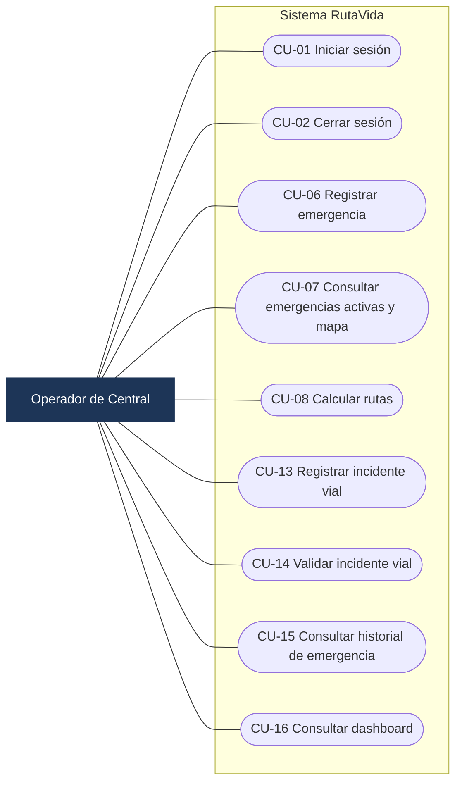
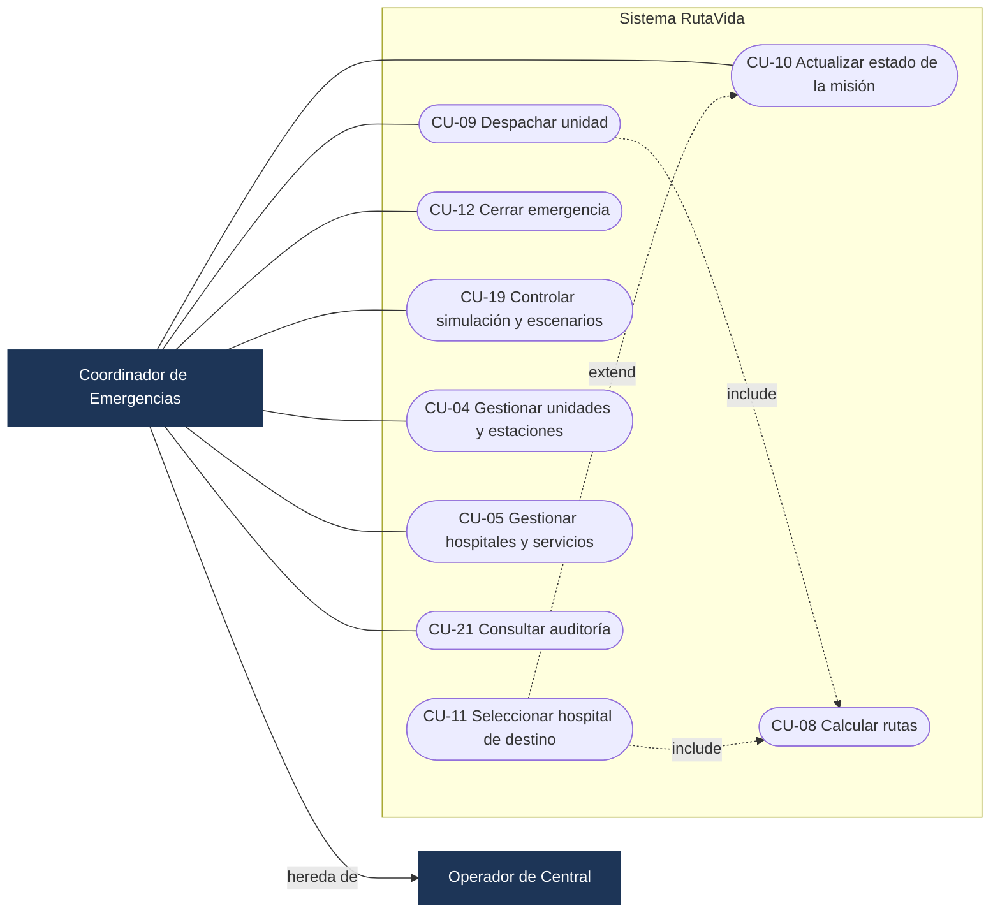
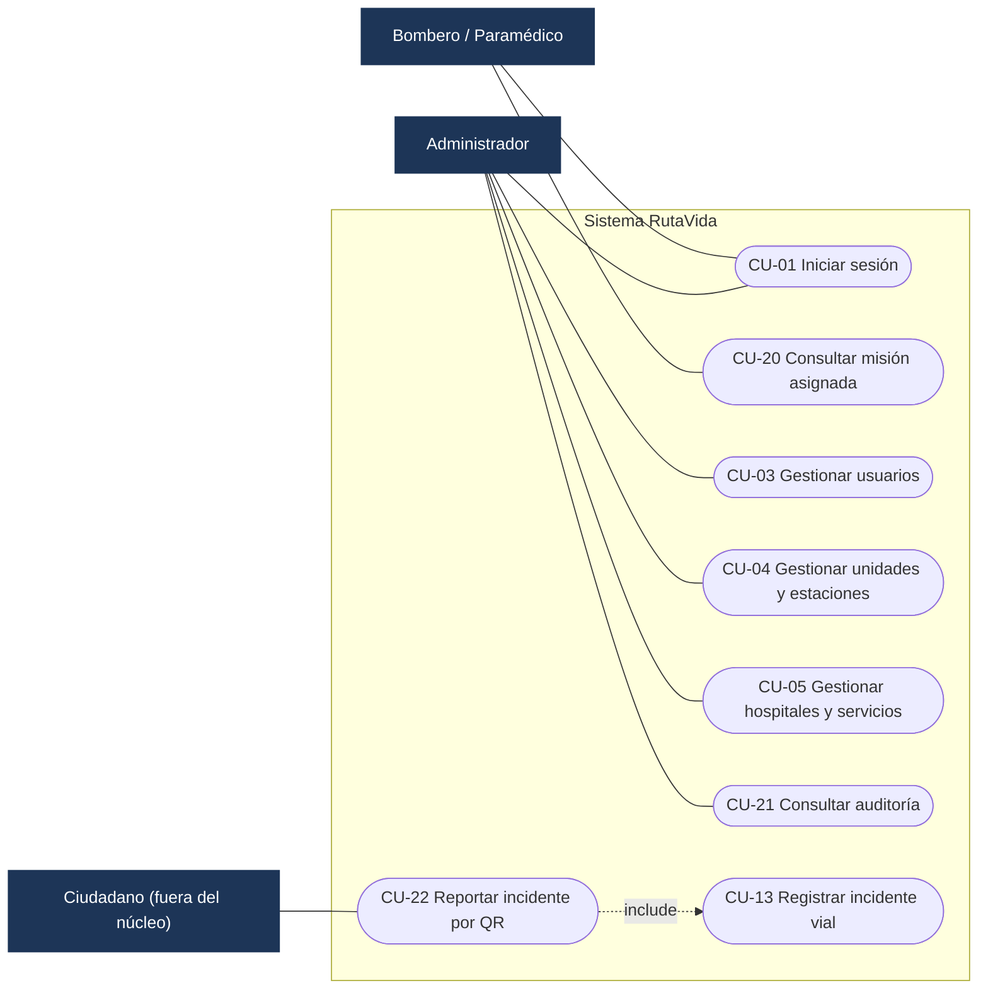
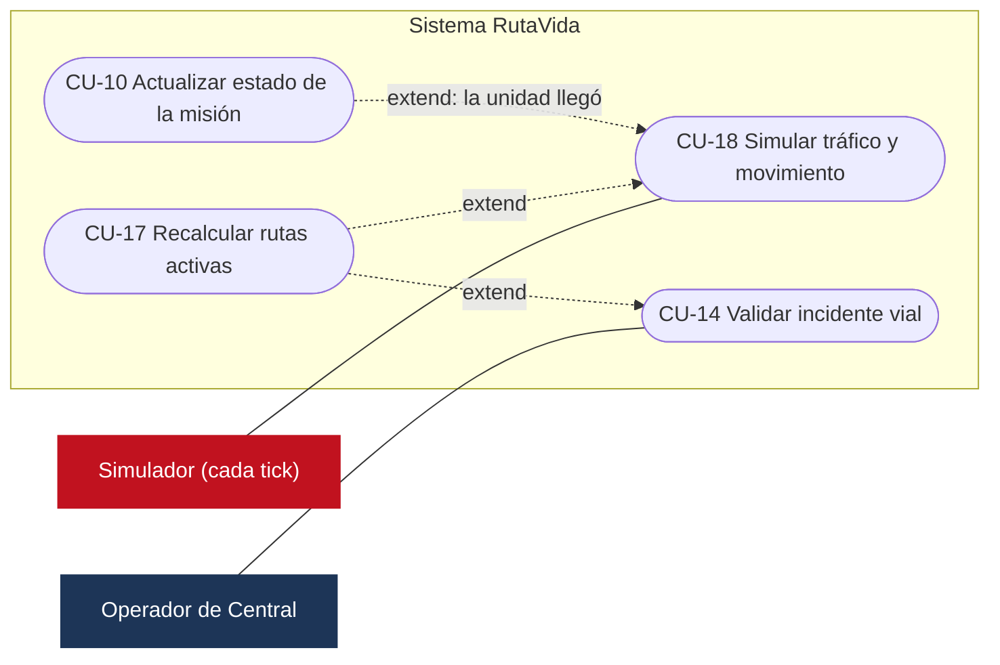

# Análisis — Casos de uso de RutaVida

Responsable: Andrés (líder).
Fecha: 14 de octubre de 2026.
Estado: **propuesta para revisión del equipo**. Base para el diagrama de clases (`docs/class-diagram.md`).

Este documento define **qué hace el sistema y quién lo usa**. Cada caso de uso indica las clases que lo implementan, para que el código siga el análisis y no al revés.

Fuentes: requerimientos RF-01 a RF-12 de la propuesta, flujo general de atención (sección 6 de la propuesta), estados y permisos de `database/` y `docs/convenciones-base-datos.md`.

---

## 1. Actores

| Actor | Tipo | Descripción | Rol en la base de datos |
|---|---|---|---|
| **Operador de Central** | Principal | Recibe el reporte, registra la emergencia, consulta rutas y registra incidentes viales | `OPERADOR_CENTRAL` |
| **Coordinador de Emergencias** | Principal | Todo lo del operador, más despachar unidades, actualizar la misión, cerrar emergencias y controlar la simulación | `COORDINADOR` |
| **Bombero / Paramédico** | Principal | Personal en la unidad: consulta su misión asignada y la ruta | `BOMBERO_PARAMEDICO` |
| **Administrador** | Principal | Gestiona usuarios y catálogos (unidades, estaciones, hospitales) y consulta la auditoría | `ADMINISTRADOR` |
| **Simulador** | Secundario (sistema, temporizado) | Cada pocos segundos cambia el tráfico simulado y mueve las unidades simuladas. En la fase 2 lo reemplazan una fuente real de tráfico y el GPS | — |
| **Ciudadano** | Secundario (fuera del núcleo) | Reporta un incidente vial escaneando un código QR | — |

El **Coordinador** hereda los casos de uso del **Operador** (generalización de actores).

---

## 2. Diagramas de casos de uso

Mermaid no tiene diagrama de casos de uso; se representan con un *flowchart*: el actor a la izquierda, los casos de uso en óvalos dentro del rectángulo del sistema y las relaciones `include` / `extend` con líneas punteadas. Se hace un diagrama por actor para que se lean sin cruces.

### 2.1 Operador de Central

### 2.2 Coordinador de Emergencias

El Coordinador **hereda** todos los casos del Operador y además tiene estos:

### 2.3 Bombero / Paramédico, Administrador y Ciudadano

### 2.4 Simulador y recálculo automático

## 3. Lista de casos de uso

**Prioridad:** N = núcleo de la primera versión (lo que se demuestra) · C = complemento · F = fase posterior.

| ID | Caso de uso | Actor(es) | Permiso requerido | RF | Prioridad |
|---|---|---|---|---|---|
| CU-01 | Iniciar sesión | Todos | — | RF-01 | N |
| CU-02 | Cerrar sesión | Todos | — | RF-01 | N |
| CU-03 | Gestionar usuarios | Administrador | `USUARIOS/GESTIONAR` | RF-01 | C |
| CU-04 | Gestionar unidades y estaciones | Administrador, Coordinador | `UNIDADES/GESTIONAR` | RF-03 | C |
| CU-05 | Gestionar hospitales y servicios | Administrador, Coordinador | `HOSPITALES/GESTIONAR` | RF-04 | C |
| CU-06 | Registrar emergencia | Operador | `EMERGENCIAS/GESTIONAR` | RF-02 | N |
| CU-07 | Consultar emergencias activas y mapa | Operador, Bombero | `EMERGENCIAS/CONSULTAR` | RF-02 | N |
| CU-08 | Calcular rutas (principal + 2 alternativas) | Operador | `RUTAS/GESTIONAR` | RF-05, RF-06, RF-07 | N |
| CU-09 | Despachar unidad | Coordinador | `DESPACHO/GESTIONAR` | RF-03, RF-09 | N |
| CU-10 | Actualizar estado de la misión | Coordinador | `DESPACHO/GESTIONAR` | RF-09 | N |
| CU-11 | Seleccionar hospital de destino | Coordinador | `DESPACHO/GESTIONAR` | RF-04 | N |
| CU-12 | Cerrar emergencia | Coordinador | `DESPACHO/GESTIONAR` | RF-02 | N |
| CU-13 | Registrar incidente vial | Operador | `INCIDENTES/GESTIONAR` | RF-08 | N |
| CU-14 | Validar incidente vial (activar o rechazar) | Operador | `INCIDENTES/GESTIONAR` | RF-08 | N |
| CU-15 | Consultar historial de emergencia | Operador | `EMERGENCIAS/CONSULTAR` | RF-02, RF-12 | N |
| CU-16 | Consultar dashboard | Operador | `REPORTES/CONSULTAR` | RF-11 | C |
| CU-17 | Recalcular rutas activas | Sistema | — (automático) | RF-05, RF-10 | N |
| CU-18 | Simular tráfico y movimiento | Simulador | — (automático) | RF-06, RF-07, RF-09 | N |
| CU-19 | Controlar simulación y escenarios de demostración | Coordinador | `TRAFICO/GESTIONAR` | RF-06 | N |
| CU-20 | Consultar misión asignada | Bombero / Paramédico | `DESPACHO/CONSULTAR` | RF-09 | C |
| CU-21 | Consultar auditoría | Administrador, Coordinador | `AUDITORIA/CONSULTAR` | RF-12 | C |
| CU-22 | Reportar incidente por QR | Ciudadano | Token firmado del QR | RF-08 | F |

**Ajuste de permisos:** CU-12 (cerrar emergencia) exige `DESPACHO/GESTIONAR`, que solo tienen el Coordinador y el Administrador. Así el Operador registra, pero no cierra, emergencias. Coincide con los datos de `02_datos_iniciales.sql`.

**Transversal a todos los casos (RF-12):** toda operación que cambia datos y todo inicio de sesión (exitoso o fallido) se registra en `AUDITORIA`.

---

## 4. Especificación de los casos del núcleo

### CU-01 · Iniciar sesión

| Campo | Contenido |
|---|---|
| Actor | Cualquier usuario registrado |
| Precondición | El usuario existe en `USUARIO` |
| Postcondición | Hay una sesión activa con el usuario, su rol y sus permisos; queda un registro en `AUDITORIA` |

**Flujo principal**
1. El usuario escribe su nombre de usuario y su contraseña.
2. El sistema busca el usuario por `username`.
3. El sistema compara la contraseña con `password_hash` (PBKDF2, nunca texto plano).
4. El sistema verifica que el usuario esté activo (`estado = 'A'`).
5. El sistema carga el rol y sus permisos.
6. El sistema registra `LOGIN / EXITO` en la auditoría.
7. El sistema muestra la pantalla principal con el nombre y el rol del usuario (arriba a la derecha).

**Flujos alternos**
- 2a / 3a. Usuario inexistente o contraseña incorrecta → mensaje único "Usuario o contraseña incorrectos" (no revela cuál de los dos falló) y auditoría `LOGIN / FALLO`.
- 4a. Usuario inactivo → "El usuario está inactivo" y auditoría `LOGIN / FALLO`.
- *a. Base de datos no disponible → "No hay conexión con la base de datos" sin mostrar detalles técnicos.

**Clases:** `LoginController` → `AuthService` → `UserDAO`, `RoleDAO`, `PasswordHasher`, `AuditService` → `UserSession`.

---

### CU-06 · Registrar emergencia

| Campo | Contenido |
|---|---|
| Actor | Operador de Central |
| Precondición | Sesión activa con `EMERGENCIAS/GESTIONAR` |
| Postcondición | Emergencia en estado `REPORTADA`, auditada y visible en el mapa de todos los operadores |

**Flujo principal**
1. El operador elige el tipo de emergencia (`ACCIDENTE_VIAL`, `INCENDIO`, `EMERGENCIA_MEDICA`, `RESCATE`).
2. Marca la ubicación en el mapa (o escribe las coordenadas) y una dirección de referencia.
3. Elige la severidad (`BAJA`, `MEDIA`, `ALTA`, `CRITICA`) y escribe una descripción opcional.
4. El sistema valida los datos (RN-03).
5. En una sola transacción: inserta la emergencia con estado `REPORTADA` y registra la auditoría.
6. El mapa y la lista de emergencias activas se actualizan.
7. El sistema ofrece continuar con CU-09 (despachar unidad).

**Flujos alternos**
- 4a. Datos incompletos o coordenadas fuera del área cubierta por la red vial cargada → mensaje con el campo que falla; no se guarda nada.
- 5a. Falla la base de datos → se deshace la transacción y se informa el error.

**Clases:** `EmergencyController` → `EmergencyService` → `EmergencyDAO`, `EmergencyTypeDAO`, `TransactionManager`, `AuditService`.

---

### CU-08 · Calcular rutas

| Campo | Contenido |
|---|---|
| Actor | Operador (también se incluye desde CU-09 y CU-11) |
| Precondición | Grafo vial cargado en memoria; origen y destino dentro de la red |
| Postcondición | Hasta 3 opciones de ruta ordenadas por tiempo, cada una con su explicación. Solo se guardan en `RUTA` cuando se despacha (CU-09) |

**Flujo principal**
1. El sistema recibe el origen (posición de la unidad o del lugar de la emergencia), el destino y el tipo de vehículo.
2. Ubica el nodo del grafo más cercano al origen y al destino.
3. Calcula la ruta más rápida con A*, usando el costo en segundos de cada tramo: tiempo con congestión + espera por semáforos + penalización por incidentes, ajustados al tipo de vehículo (RN-07).
4. Calcula dos alternativas penalizando los tramos ya usados y descarta las que son casi iguales o demasiado lentas (RN-08).
5. Para cada opción arma la explicación: distancia, tiempo, número de semáforos, tramos congestionados e incidentes evitados.
6. Muestra las 3 rutas en el mapa con colores distintos y la recomendada resaltada.

**Flujos alternos**
- 3a. No existe camino (por ejemplo, por cierres) → "No hay ruta disponible con las condiciones actuales".
- 4a. Solo existen 1 o 2 rutas suficientemente distintas → se muestran las que hay y se indica por qué no hay más.

**Clases:** `RouteController` → `RouteService` → `RoadGraph`, `AStarRouter`, `AlternativeRouteFinder`, `CostFunction` / `EmergencyCost`, `RouteExplanationBuilder` → `RouteOption` (DTO).

---

### CU-09 · Despachar unidad

| Campo | Contenido |
|---|---|
| Actor | Coordinador de Emergencias |
| Precondición | Emergencia en estado `REPORTADA`; al menos una unidad `DISPONIBLE` |
| Postcondición | Asignación `ASIGNADA`, emergencia `ASIGNADA`, unidad `OCUPADO`, ruta principal `ACTIVA` y alternativas `PROPUESTA`; todo auditado |

**Flujo principal**
1. El coordinador abre una emergencia `REPORTADA`.
2. El sistema calcula el tiempo estimado de llegada (ETA) de cada unidad disponible de un tipo adecuado (incluye CU-08) y las ordena de menor a mayor.
3. El coordinador elige una unidad (por defecto, la de menor ETA).
4. El sistema muestra las 3 rutas de esa unidad hasta la emergencia.
5. El coordinador confirma el despacho.
6. En **una sola transacción**: crea la asignación, cambia la emergencia a `ASIGNADA`, cambia la unidad a `OCUPADO`, guarda las rutas en `RUTA` / `RUTA_TRAMO` y registra la auditoría.
7. `DispatchService` avisa a `AlertService` y al simulador; la unidad empieza a moverse en el mapa (simulación, CU-18).

**Flujos alternos**
- 2a. No hay unidades disponibles → "No hay unidades disponibles" y la emergencia sigue `REPORTADA`.
- 6a. Otro coordinador asignó la misma unidad un instante antes → la base de datos lo impide (índice único de asignación abierta) y el sistema pide elegir otra unidad.
- 6b. Falla cualquier escritura → se deshace todo.

**Varias emergencias a la vez (extensión):** con N emergencias pendientes y M unidades, `DispatchService` arma la matriz de ETA y la resuelve con el algoritmo húngaro (asignación óptima, Investigación de Operaciones).

**Clases:** `DispatchController` → `DispatchService` → `EmergencyDAO`, `EmergencyVehicleDAO`, `EmergencyAssignmentDAO`, `RouteService`, `RouteDAO`, `HungarianAlgorithm`, `TransactionManager`, `AuditService`, `AlertService`.

---

### CU-10 · Actualizar estado de la misión (incluye CU-11)

| Campo | Contenido |
|---|---|
| Actor | Coordinador (la llegada al sitio también la puede marcar automáticamente el simulador) |
| Precondición | Asignación abierta |
| Postcondición | Asignación y emergencia con el mismo estado nuevo; horas registradas; auditoría |

**Flujo principal**
1. El coordinador elige la siguiente fase: `EN_RUTA` → `EN_SITIO` → `TRASLADANDO` → `FINALIZADA`.
2. El sistema valida la transición (RN-01, RN-02).
3. En una transacción: actualiza la asignación (`hora_salida` al pasar a `EN_RUTA`, `hora_llegada` al pasar a `EN_SITIO`), la emergencia y la auditoría.
4. El mapa y los paneles muestran el nuevo estado.

**Extensión CU-11 · Seleccionar hospital** (al pasar a `TRASLADANDO`)
1. El sistema lista los hospitales operativos que tienen el servicio requerido.
2. Los ordena por costo = ETA del traslado + penalización por baja disponibilidad (RN-10).
3. El coordinador confirma uno; el sistema calcula las rutas de traslado (CU-08) y las guarda con `id_hospital_destino`.

**Flujos alternos**
- 2a. Transición no permitida (por ejemplo, de `ASIGNADA` a `TRASLADANDO`) → mensaje y no se cambia nada.
- 1a. La unidad se avería → la asignación pasa a `CANCELADA`, la unidad a `MANTENIMIENTO`, la emergencia vuelve a `REPORTADA` y se repite CU-09.

**Clases:** `DispatchController` → `DispatchService`, `HospitalService`, `RouteService`.

---

### CU-12 · Cerrar emergencia

| Campo | Contenido |
|---|---|
| Actor | Coordinador |
| Precondición | Emergencia `EN_SITIO` o `TRASLADANDO`, o `REPORTADA` si fue una falsa alarma |
| Postcondición | Emergencia `CERRADA` con `fecha_hora_cierre`; asignación `FINALIZADA`; unidad `DISPONIBLE`; rutas `FINALIZADA` |

**Flujo principal**
1. El coordinador elige "Cerrar emergencia".
2. El sistema valida la transición.
3. En una transacción: cierra la emergencia, finaliza la asignación y las rutas activas, libera la unidad y audita.
4. El sistema calcula los tiempos de respuesta (asignación → salida → llegada → cierre) para el dashboard.
5. El mapa y los paneles muestran la emergencia cerrada.

**Clases:** `DispatchController` → `DispatchService` → `EmergencyDAO`, `EmergencyAssignmentDAO`, `EmergencyVehicleDAO`, `RouteDAO`, `TransactionManager`, `AuditService`.

---

### CU-14 · Validar incidente vial

| Campo | Contenido |
|---|---|
| Actor | Operador |
| Precondición | Incidente en estado `PENDIENTE` (creado en CU-13, por QR o por un escenario de demostración) |
| Postcondición | Incidente `ACTIVO` (afecta las rutas) o `RECHAZADO` (no las afecta) |

**Flujo principal**
1. El operador revisa el incidente pendiente en el mapa.
2. Lo activa e indica si bloquea el tramo (`bloquea_tramo = S`) o solo lo penaliza.
3. El sistema actualiza el estado del tramo en el grafo en memoria (RN-05).
4. `IncidentService` llama a `RouteMonitor.checkActiveRoutes` → se dispara CU-17 para las rutas activas que pasan por ese tramo.

**Flujo alterno**
- 2a. El operador lo rechaza → estado `RECHAZADO`; el grafo no cambia.

**Clases:** `IncidentController` → `IncidentService` → `RoadIncidentDAO`, `RoadConditionService`, `RouteMonitor`.

---

### CU-17 · Recalcular rutas activas (automático)

| Campo | Contenido |
|---|---|
| Actor | Sistema (lo disparan CU-14 y CU-18) |
| Precondición | Hay al menos una ruta `ACTIVA` |
| Postcondición | Si hubo una mejora suficiente, la nueva ruta queda `ACTIVA`, la anterior `DESCARTADA`, y el coordinador recibe una alerta |

**Flujo principal**
1. `SimulationEngine` (después de actualizar el tráfico) o `IncidentService` (al activar un incidente) llama a `RouteMonitor.checkActiveRoutes` con los tramos que cambiaron.
2. El sistema busca las rutas activas que pasan por los tramos afectados.
3. Para cada una, calcula la mejor ruta desde la **posición actual** de la unidad hasta su destino.
4. Si la nueva ruta mejora el tiempo restante por encima del umbral (RN-09) o la ruta actual quedó bloqueada:
   - en una transacción, guarda la nueva ruta como `ACTIVA` y marca la anterior `DESCARTADA`;
   - crea una alerta `RECALCULO_RUTA` para el coordinador;
   - el mapa dibuja la nueva ruta y muestra el tiempo ganado.

**Flujo alterno**
- 4a. La mejora no supera el umbral → no se cambia nada (evita que la ruta "parpadee").

**Clases:** `RouteMonitor` → `RouteService`, `RouteDAO`, `AlertService`.

---

### CU-18 · Simular tráfico y movimiento (automático)

| Campo | Contenido |
|---|---|
| Actor | Simulador (cada *tick*, por defecto cada 5 s; configurable) |
| Precondición | Simulación iniciada (CU-19) |
| Postcondición | Grafo con congestión y semáforos actualizados; unidades movidas; historial guardado por lotes |

**Flujo principal (cada tick)**
1. El proveedor de tráfico simulado genera cambios de congestión y de semáforos (nunca cierra tramos: RN-06).
2. `RoadConditionService` combina tráfico + incidentes y actualiza el grafo.
3. El simulador de movimiento avanza cada unidad en misión a lo largo de su ruta activa.
4. El mapa muestra el tráfico y las posiciones nuevas.
5. Cada N ticks se guardan `TRAFICO` y `UBICACION_VEHICULO` con fuente `SIMULACION` (RN-11).
6. Si una unidad llega a su destino, el sistema pasa la misión a `EN_SITIO` (CU-10).

**Extensión:** si los cambios afectan una ruta activa → CU-17.

**Clases:** `SimulationEngine` → `RoadConditionService` (con `TrafficProvider` / `SimulatedTrafficProvider`), `TrackingService` (con `VehiclePositionSource` / `VehicleMovementSimulator`).

---

## 5. Reglas de negocio

| ID | Regla | Dónde se garantiza |
|---|---|---|
| RN-01 | Una emergencia solo cambia de estado siguiendo el flujo `REPORTADA → ASIGNADA → EN_RUTA → EN_SITIO → (TRASLADANDO) → CERRADA` (más el regreso a `REPORTADA` si se cancela la asignación y el cierre directo por falsa alarma) | `EmergencyService.canChange()` / `changeStatus()` (programado) |
| RN-02 | Solo se despachan unidades `DISPONIBLE`, y una unidad tiene como máximo una asignación abierta | `DispatchService.isDispatchable()` + índice único `ux_asignacion_vehiculo_abierta` |
| RN-03 | Una emergencia exige tipo, coordenadas válidas dentro de la red vial cargada, dirección de referencia y severidad | `EmergencyService` + CHECK de Oracle |
| RN-04 | Las contraseñas se guardan con hash PBKDF2 y sal; nunca en texto plano | `PasswordHasher` |
| RN-05 | Un incidente nuevo queda `PENDIENTE` y solo los `ACTIVO` afectan las rutas | `IncidentService.affectsRouting()` + DEFAULT en Oracle |
| RN-06 | El simulador de tráfico cambia la congestión y los semáforos, pero no cierra tramos; los cierres vienen solo de incidentes | `TrafficProvider` / `RoadConditionService` |
| RN-07 | El costo de un tramo se mide en segundos e incluye congestión, semáforos e incidentes, ajustado al tipo de vehículo | `EmergencyCost` |
| RN-08 | Las alternativas se descartan si comparten más del 80 % de los tramos con otra ruta o tardan más de 1,5 veces la mejor | `AlternativeRouteFinder` |
| RN-09 | Una ruta activa se reemplaza solo si la nueva mejora el tiempo restante en más del 15 % o en más de 30 s, o si la actual quedó bloqueada | `RouteMonitor` |
| RN-10 | El hospital de traslado debe estar operativo y tener el servicio requerido; se elige por menor ETA con penalización por baja disponibilidad | `HospitalService` |
| RN-11 | Los datos simulados se marcan `SIMULACION` y nunca se presentan como reales; el historial se guarda por lotes | Enums `TrafficSource`, `PositionSource` |
| RN-12 | Toda operación que modifica datos y todo inicio de sesión se audita | `AuditService` |

Los valores de RN-08 y RN-09 (80 %, 1,5×, 15 %, 30 s) son **parámetros iniciales a calibrar** con pruebas, no datos medidos.

---

## 6. Trazabilidad requerimientos ↔ casos de uso

| Requerimiento | Casos de uso |
|---|---|
| RF-01 Autenticación | CU-01, CU-02, CU-03 |
| RF-02 Emergencias | CU-06, CU-07, CU-12, CU-15 |
| RF-03 Unidades | CU-04, CU-09 |
| RF-04 Hospitales | CU-05, CU-11 |
| RF-05 Rutas | CU-08, CU-17 |
| RF-06 Tráfico | CU-08, CU-18, CU-19 |
| RF-07 Semáforos | CU-08, CU-18 |
| RF-08 Incidentes | CU-13, CU-14, CU-22 |
| RF-09 Seguimiento | CU-09, CU-10, CU-18, CU-20 |
| RF-10 Alertas | CU-17 (y alertas de disponibilidad) |
| RF-11 Reportes | CU-16 |
| RF-12 Auditoría | CU-21 y transversal a todos |

## 7. Escenario de la demostración (une los casos del núcleo)

1. El operador inicia sesión (CU-01) y registra un accidente en Valledupar (CU-06).
2. El coordinador despacha la ambulancia con menor ETA; se ven 3 rutas con su explicación (CU-09, CU-08).
3. La ambulancia empieza a moverse en el mapa (CU-18).
4. El coordinador ejecuta el escenario "accidente en la vía de la ruta recomendada" (CU-19 → CU-13 → CU-14).
5. El sistema recalcula y muestra la nueva ruta con el tiempo ganado (CU-17).
6. La unidad llega, traslada al paciente al hospital elegido y se cierra la emergencia (CU-10, CU-11, CU-12).
7. Se consulta el historial completo y el dashboard (CU-15, CU-16).
