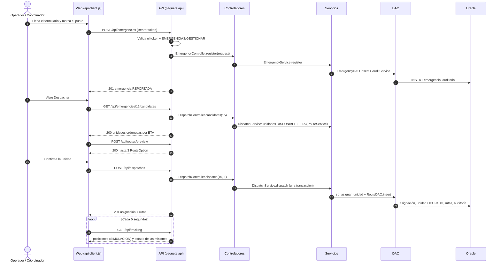

# Contrato de la API REST

Este documento define cada ruta de la API del núcleo de RutaVida: método, URL, permiso, JSON de entrada, JSON de salida y errores. La web (`frontend/js/api-client.js`) programa contra este contrato, y el servidor (tarea A12) lo implementa. **Nadie programa una ruta que no esté aquí**: si hace falta una nueva o un cambio, se actualiza este documento en un PR y lo aprueba el equipo.

| Dato | Valor |
|---|---|
| Estado | **Aprobado por el equipo** el 05/11/2026 (A10), con las decisiones DT-06, DT-07 y DT-08 de `docs/decisiones-tecnicas.md` |
| Revisan | Diego (consume la API) y Sherly (controladores) |
| Casos de uso | `docs/analysis.md`, sección 3 |
| Permisos | Tabla `PERMISO` (`database/02_datos_iniciales.sql`) |

**Todos los JSON de este documento son de EJEMPLO.** Los ids, las horas y los valores no salen de Oracle. Sirven para que la web pruebe sus pantallas antes de que exista el servidor.

## 1. Convenciones

| Tema | Regla |
|---|---|
| Dirección | `http://localhost:8080/api/...`. El mismo servidor entrega las páginas de `frontend/` (DT-06), así que la web llama con rutas relativas (`/api/emergencies`) y no hace falta CORS |
| URLs | En inglés, en plural y en minúsculas con guiones: `/api/emergency-types`. Los ids van en la ruta: `/api/emergencies/15` |
| Formato | JSON en UTF-8, en la petición y en la respuesta (`Content-Type: application/json`) |
| Nombres de los campos | En inglés y en *camelCase*, iguales a los getters de las clases del modelo y de los DTO: `addressReference`, `reportedAt`, `operationalStatus` |
| Estados y catálogos | Viajan con su **código en español**, el mismo de Oracle: `"REPORTADA"`, `"CRITICA"`, `"DISPONIBLE"`, `"PRINCIPAL"`. Nunca el nombre del enum en Java (`REPORTED`) |
| Fechas y horas | Texto ISO-8601 sin zona, en hora de Colombia: `"2026-11-04T09:30:15"`. Un valor sin dato es `null` |
| Coordenadas | Siempre un objeto: `{"latitude": 10.467172, "longitude": -73.265099}`, con 6 decimales. También dentro de las listas (el trazado de una ruta es una lista de estos objetos) |
| Números | Distancias en km (`distanceKm`), tiempos en minutos (`estimatedMinutes`, `etaMinutes`), con decimales |
| Datos simulados | Todo lo que viene del simulador lleva `"source": "SIMULACION"`, y la web lo rotula así. Nunca se muestra como GPS ni como tráfico real |
| Contraseñas | Ninguna respuesta incluye `passwordHash` ni la contraseña |
| Caché | Toda respuesta de la API lleva `Cache-Control: no-store` y `X-Content-Type-Options: nosniff`: trae tokens y datos personales, así que el navegador no la guarda |

### 1.1 Forma de todas las respuestas

Todas las respuestas, con éxito o con error, tienen la misma forma que `OperationResult`:

```json
{ "success": true, "message": null, "value": { "id": 15 } }
```

```json
{ "success": false, "message": "La latitud debe estar entre -90 y 90.", "value": null }
```

- `value` es lo que pide la ruta: un objeto, una lista o `null` cuando la operación no devuelve nada.
- `message` es el texto en español para el usuario. La web lo muestra tal cual y **nunca** muestra detalles técnicos.

### 1.2 Códigos HTTP y errores

| Código | Cuándo | De dónde sale el mensaje |
|---|---|---|
| `200` | Consulta o cambio correcto | — |
| `201` | Se creó algo (emergencia, despacho, incidente) | — |
| `400` | Datos inválidos: falta un campo, una coordenada fuera de rango, un JSON mal escrito | `ValidationException` |
| `401` | Sin sesión, token inválido o vencido | `"Debe iniciar sesión."` (`Messages.SESSION_REQUIRED`) |
| `403` | Con sesión, pero el rol no tiene el permiso de la ruta | `AccessDeniedException` |
| `404` | El id de la ruta no existe | `"No se encontró la información solicitada."` (`Messages.NOT_FOUND`) |
| `409` | Se rompe una regla de negocio: transición de estado no permitida, unidad ocupada | `BusinessRuleException` |
| `503` | Oracle no responde | `"No hay conexión con la base de datos."` (`Messages.DATABASE_DOWN`) |
| `500` | Cualquier otro error | `"Ocurrió un error inesperado. Intente de nuevo."` (`Messages.UNEXPECTED`) |

El servidor registra el detalle técnico en el log, nunca en la respuesta.

## 2. Seguridad (DT-08)

1. La web inicia sesión con `POST /api/auth/login` y recibe un `token`.
2. La web guarda el token en `sessionStorage` (se borra al cerrar la pestaña) y lo envía en **todas** las demás peticiones. El token de un **ciudadano** (rol `CIUDADANO`, DT-13) va en `localStorage`, para que el celular siga conectado al cerrar el navegador:

   ```
   Authorization: Bearer 3f9c2a…
   ```

3. El token es un valor aleatorio de 32 bytes (`SecureRandom`) que el servidor guarda en memoria junto con la sesión (`UserSession`). Deja de servir en el primero de estos casos:
   - **30 minutos sin uso.** Cada petición del usuario reinicia el contador, **excepto** las consultas automáticas del mapa (`GET /api/tracking`, `GET /api/traffic/segments` y `GET /api/alerts`): si las contara, una pestaña abierta nunca vencería.
   - **8 horas** desde el inicio de sesión (un turno), aunque el usuario siga activo.
   - `POST /api/auth/logout`.

   Si el servidor se reinicia, todos tienen que volver a iniciar sesión.

   **Excepción, el ciudadano (DT-13):** su sesión dura **30 días** y no vence por inactividad. El servidor no la guarda en memoria sino en la tabla `SESION_CIUDADANO` (`database/08_ciudadanos.sql`), y solo el hash SHA-256 del token: sobrevive a un reinicio del servidor. Deja de servir a los 30 días, con `POST /api/auth/logout` o cuando la cuenta se bloquea (RN-16), que cierra todas sus sesiones.
4. Cada ruta exige el permiso de la columna **Permiso** (módulo y acción de la tabla `PERMISO`). El servidor lo revisa con `AuthService.requirePermission` antes de llamar al controlador. Que la web oculte un botón no reemplaza esta revisión.
5. Las únicas rutas sin token son `POST /api/auth/login`, `POST /api/citizens` (crear la cuenta de ciudadano, 16.5), `GET /api/panic/emergency-types` (16.4) y las páginas de `frontend/`. Desde DT-13, `POST /api/panic` **sí pide token**.

## 3. Resumen de rutas

| # | Método | URL | Permiso | Caso de uso |
|---|---|---|---|---|
| 1 | `POST` | `/api/auth/login` | Ninguno | CU-01 |
| 2 | `POST` | `/api/auth/logout` | Sesión | CU-02 |
| 3 | `GET` | `/api/auth/session` | Sesión | CU-01 |
| 4 | `GET` | `/api/emergency-types` | `EMERGENCIAS/CONSULTAR` | CU-06 |
| 5 | `GET` | `/api/emergencies` (con `?from=&to=`: las de un periodo) | `EMERGENCIAS/CONSULTAR` | CU-07, CU-15 |
| 6 | `POST` | `/api/emergencies` | `EMERGENCIAS/GESTIONAR` | CU-06 |
| 7 | `GET` | `/api/emergencies/{id}` | `EMERGENCIAS/CONSULTAR` | CU-07 |
| 8 | `GET` | `/api/emergencies/{id}/history` | `EMERGENCIAS/CONSULTAR` | CU-15 |
| 9 | `GET` | `/api/emergencies/{id}/candidates` | `DESPACHO/GESTIONAR` | CU-09 |
| 10 | `POST` | `/api/routes/preview` | `RUTAS/GESTIONAR` | CU-08 |
| 11 | `POST` | `/api/dispatches` | `DESPACHO/GESTIONAR` | CU-09 |
| 12 | `GET` | `/api/dispatches/{id}/routes` | `RUTAS/CONSULTAR` | CU-08, CU-17 |
| 13 | `GET` | `/api/dispatches/{id}/hospitals` | `DESPACHO/GESTIONAR` | CU-11 |
| 14 | `PATCH` | `/api/dispatches/{id}/status` | `DESPACHO/GESTIONAR` | CU-10, CU-11 |
| 15 | `POST` | `/api/emergencies/{id}/close` | `DESPACHO/GESTIONAR` | CU-12 |
| 16 | `GET` | `/api/vehicle-types` | `UNIDADES/CONSULTAR` | CU-04 |
| 17 | `GET` | `/api/units` | `UNIDADES/CONSULTAR` | CU-07 |
| 18 | `GET` | `/api/stations` | `UNIDADES/CONSULTAR` | CU-07 |
| 19 | `GET` | `/api/hospitals` | `HOSPITALES/CONSULTAR` | CU-07, CU-11 |
| 20 | `GET` | `/api/tracking` | `EMERGENCIAS/CONSULTAR` | CU-07, CU-18 |
| 21 | `GET` | `/api/traffic/segments` | `TRAFICO/CONSULTAR` | CU-07 |
| 22 | `GET` | `/api/incidents` | `INCIDENTES/CONSULTAR` | CU-07 |
| 23 | `POST` | `/api/incidents` | `INCIDENTES/GESTIONAR` | CU-13 |
| 24 | `PATCH` | `/api/incidents/{id}/status` | `INCIDENTES/GESTIONAR` | CU-14 |
| 25 | `GET` | `/api/simulation` | `TRAFICO/CONSULTAR` | CU-19 |
| 26 | `POST` | `/api/simulation/start` | `TRAFICO/GESTIONAR` | CU-19 |
| 27 | `POST` | `/api/simulation/stop` | `TRAFICO/GESTIONAR` | CU-19 |
| 28 | `POST` | `/api/simulation/traffic` | `TRAFICO/GESTIONAR` | CU-19 |
| 29 | `GET` | `/api/dashboard/summary` | `REPORTES/CONSULTAR` | CU-16 |
| 30 | `GET` | `/api/alerts` | Sesión | RF de alertas |
| 31 | `PATCH` | `/api/alerts/{id}/read` | Sesión | RF de alertas |
| 32 | `GET` | `/api/users` | `USUARIOS/CONSULTAR` | CU-03 |
| 33 | `POST` | `/api/users` | `USUARIOS/GESTIONAR` | CU-03 |
| 34 | `PATCH` | `/api/users/{id}/status` | `USUARIOS/GESTIONAR` | CU-03 |
| 35 | `GET` | `/api/roles` | `USUARIOS/CONSULTAR` | CU-03 |
| 36 | `POST` | `/api/auth/password` | Sesión | CU-03 |
| 37 | `POST` | `/api/units` | `UNIDADES/GESTIONAR` | CU-04 |
| 38 | `PUT` | `/api/units/{id}` | `UNIDADES/GESTIONAR` | CU-04 |
| 39 | `PATCH` | `/api/units/{id}/status` | `UNIDADES/GESTIONAR` | CU-04 |
| 40 | `POST` | `/api/stations` | `UNIDADES/GESTIONAR` | CU-04 |
| 41 | `PUT` | `/api/stations/{id}` | `UNIDADES/GESTIONAR` | CU-04 |
| 42 | `PATCH` | `/api/stations/{id}/status` | `UNIDADES/GESTIONAR` | CU-04 |
| 43 | `POST` | `/api/hospitals` | `HOSPITALES/GESTIONAR` | CU-05 |
| 44 | `PUT` | `/api/hospitals/{id}` | `HOSPITALES/GESTIONAR` | CU-05 |
| 45 | `PATCH` | `/api/hospitals/{id}/status` | `HOSPITALES/GESTIONAR` | CU-05 |
| 46 | `POST` | `/api/panic` | `PANICO/REPORTAR` (ciudadano con cuenta, policía o administrador; DT-13) | CU-22 |
| 47 | `GET` | `/api/panic/reports` | `PANICO/CONSULTAR` | CU-22 |
| 48 | `PATCH` | `/api/panic/reports/{id}/status` | `PANICO/GESTIONAR` | CU-22 |
| 49 | `GET` | `/api/audit` | `AUDITORIA/CONSULTAR` | CU-21 |
| 50 | `GET` | `/api/reports/operations` | `REPORTES/CONSULTAR` | RF-11 |
| 51 | `GET` | `/api/panic/emergency-types` | Ninguno (pública, solo lectura) | CU-22 |
| 52 | `POST` | `/api/citizens` | Ninguno (pública, máximo 10 cuentas por hora por dirección de red) | CU-23 |

"Sesión" significa que basta con un token válido, sin un permiso específico.

## 4. Sesión

### 4.1 `POST /api/auth/login`

Entrada:

```json
{ "username": "operador1", "password": "texto-que-escribe-el-usuario" }
```

Salida `200`:

```json
{
   "success": true,
   "message": null,
   "value": {
      "token": "3f9c2a7e0b5d4c18a6e2f9d1b7c4a0e53f9c2a7e0b5d4c18a6e2f9d1b7c4a0e5",
      "expiresAt": "2026-11-04T17:30:00",
      "idleTimeoutMinutes": 30,
      "user": { "id": 3, "username": "operador1", "firstNames": "Ana", "lastNames": "Pérez" },
      "role": "OPERADOR_CENTRAL",
      "permissions": ["EMERGENCIAS:CONSULTAR", "EMERGENCIAS:GESTIONAR", "RUTAS:GESTIONAR"]
   }
}
```

Errores (mensajes de `AuthService`): `400` con `"Escriba el usuario y la contraseña."`; `401` con `"Usuario o contraseña incorrectos"`, el mismo para un usuario que no existe y para una contraseña errada, para no revelar cuál falló; `401` con `"El usuario está inactivo"`. En esta ruta, los errores de credenciales son `401` aunque `AuthService` los lance como `BusinessRuleException`.

**Contra adivinar contraseñas:** después de **5 intentos fallidos** del mismo usuario desde la misma dirección de red en **10 minutos** (o 30 fallidos de cualquier usuario desde una dirección), la ruta responde `409` con `"Demasiados intentos fallidos de inicio de sesión. Espere 10 minutos antes de intentarlo de nuevo."` sin revisar la contraseña. Solo cuentan los `401`: quien escribe bien la contraseña nunca se bloquea, y un inicio de sesión correcto borra los fallos de su cuenta. Los contadores viven en memoria y se reinician con el servidor. Cada intento fallido queda además en `AUDITORIA`.

`expiresAt` es el límite de 8 horas; `idleTimeoutMinutes` es el límite por inactividad. La web usa `permissions` solo para mostrar u ocultar botones.

Para un usuario con rol `CIUDADANO` (DT-13) la respuesta tiene la misma forma, con `expiresAt` **30 días** después del inicio de sesión e `"idleTimeoutMinutes": 0` (no vence por inactividad). La web lo manda a `panico.html` en lugar del panel. Un ciudadano bloqueado por alertas falsas (RN-16) recibe el mismo `401` de usuario inactivo.

### 4.2 `POST /api/auth/logout`

Sin cuerpo. Invalida el token. Salida `200` con `value: null`. Si el token ya no era válido, responde igual `200`.

### 4.3 `GET /api/auth/session`

Devuelve el mismo `value` del login, sin `token`. La web lo llama al abrir una página para saber si la sesión sigue viva; si recibe `401`, vuelve a `index.html`.

## 5. Emergencias

### 5.1 `GET /api/emergency-types`

```json
{ "success": true, "message": null, "value": [
   { "id": 1, "name": "EMERGENCIA_MEDICA", "priority": 9, "description": "Urgencia medica sin accidente de transito" },
   { "id": 3, "name": "ACCIDENTE_VIAL", "priority": 8, "description": "Accidente de transito con posibles lesionados" }
] }
```

Ordenados de mayor a menor prioridad (`EmergencyTypeDAO.findAll`).

### 5.2 `GET /api/emergencies`

Las emergencias que no están `CERRADA`, la más reciente primero (`EmergencyDAO.findActive`). Cada una es la entidad `Emergency`:

```json
{ "success": true, "message": null, "value": [
   {
      "id": 15,
      "emergencyTypeId": 3,
      "reportedByUserId": 3,
      "addressReference": "Frente al Parque La Popa",
      "location": { "latitude": 10.467172, "longitude": -73.265099 },
      "reportedAt": "2026-11-04T09:30:15",
      "severity": "CRITICA",
      "description": "Choque entre dos vehículos",
      "status": "REPORTADA",
      "closedAt": null
   }
] }
```

El nombre del tipo se toma del catálogo (5.1) con `emergencyTypeId`.

**Con periodo (historial, CU-15 y D10):** `GET /api/emergencies?from=2026-11-08&to=2026-11-14` devuelve **todas** las emergencias reportadas entre esos dos días, también las `CERRADA`, la más reciente primero y con la misma forma. Los parámetros siguen las reglas de 11.4: `from` desde las 00:00, `to` hasta las 24:00; si falta `to` es hoy, si falta `from` son los 7 días que terminan en `to`; como máximo 366 días. Basta con enviar uno de los dos para pedir el periodo; sin ninguno, la ruta devuelve las abiertas, como siempre. Errores: `400` si una fecha no tiene la forma `2026-11-14`, si `from` es posterior a `to` o si el periodo pasa de 366 días.

### 5.3 `POST /api/emergencies`

Registra una emergencia (CU-06). Entrada, igual al DTO `EmergencyRequest`:

```json
{
   "emergencyTypeId": 3,
   "addressReference": "Frente al Parque La Popa",
   "location": { "latitude": 10.467172, "longitude": -73.265099 },
   "severity": "CRITICA",
   "description": "Choque entre dos vehículos"
}
```

- `description` es opcional (`null` o se omite).
- El servidor pone `reportedAt` (su reloj), `reportedByUserId` (el usuario del token) y `status` = `REPORTADA`. Si la web los envía, se ignoran.

Salida `201`: la emergencia creada, con su `id` (misma forma de 5.2).

Errores `400`: tipo inexistente, dirección vacía, coordenadas fuera de rango, severidad desconocida.

### 5.4 `GET /api/emergencies/{id}`

Una emergencia, con la forma de 5.2. `404` si no existe.

### 5.5 `GET /api/emergencies/{id}/history`

Todo lo que pasó con una emergencia (CU-15), igual al DTO `EmergencyHistory`:

```json
{ "success": true, "message": null, "value": {
   "emergency": { "id": 15, "status": "CERRADA", "...": "misma forma de 5.2" },
   "assignments": [
      { "id": 8, "emergencyId": 15, "vehicleId": 1, "coordinatorUserId": 4,
         "assignedAt": "2026-11-04T09:32:00", "departedAt": "2026-11-04T09:33:10",
         "arrivedAt": "2026-11-04T09:41:45", "status": "FINALIZADA" }
   ],
   "routes": [
      { "id": 30, "emergencyId": 15, "vehicleId": 1, "destinationHospitalId": null,
         "type": "PRINCIPAL", "distanceKm": 2.84, "estimatedMinutes": 6.9, "totalCost": 414.0,
         "generatedAt": "2026-11-04T09:32:00", "recommended": true, "status": "FINALIZADA" }
   ],
   "auditTrail": [
      { "id": 101, "userId": 3, "module": "EMERGENCIAS", "operation": "REGISTRAR", "recordId": 15,
         "occurredAt": "2026-11-04T09:30:15", "result": "EXITO", "detail": "Emergencia registrada" },
      { "id": 102, "userId": 4, "module": "EMERGENCIAS", "operation": "CAMBIO_ESTADO", "recordId": 15,
         "occurredAt": "2026-11-04T09:32:00", "result": "EXITO", "detail": "REPORTADA -> ASIGNADA" }
   ]
} }
```

Las rutas del historial no traen el trazado: el historial es para leer, no para dibujar. Los tramos de cada ruta no se incluyen.

## 6. Despacho y rutas

Estado: 6.1, 6.2, 6.3, 6.4 y 6.6 (A12d) y 6.7 (A16) están programadas. 6.5 y el paso a `TRASLADANDO` esperan el traslado al hospital (CU-11, K7b).

### 6.1 `GET /api/emergencies/{id}/candidates`

Las unidades que pueden atender la emergencia (CU-09, paso 2): solo `DISPONIBLE` y de un tipo adecuado para la emergencia (regla `DispatchService.suits`, K7: `EMERGENCIA_MEDICA` → `AMBULANCIA`; `INCENDIO` y `RESCATE` → `BOMBERO`; `ACCIDENTE_VIAL` → las dos; otro tipo → todas). Una unidad sin posición sale desde su estación, y una que no llega por la red vial cargada no aparece. Ordenadas por tiempo estimado de llegada, la más rápida primero:

```json
{ "success": true, "message": null, "value": [
  { "vehicleId": 1, "unitCode": "EJEMPLO-AMB-01", "vehicleType": "AMBULANCIA",
    "stationName": "EJEMPLO - Base de ambulancias",
    "location": { "latitude": 10.469330, "longitude": -73.254520 },
    "etaMinutes": 6.9, "distanceKm": 2.84 },
  { "vehicleId": 2, "unitCode": "EJEMPLO-AMB-02", "vehicleType": "AMBULANCIA",
    "stationName": "EJEMPLO - Base de ambulancias",
    "location": { "latitude": 10.469330, "longitude": -73.254520 },
    "etaMinutes": 6.9, "distanceKm": 2.84 }
] }
```

Lista vacía si no hay unidades disponibles (la web muestra "No hay unidades disponibles"). `409` si la emergencia no está `REPORTADA`.

### 6.2 `POST /api/routes/preview`

Calcula las rutas de una unidad hasta la emergencia **sin guardar nada** (CU-08). La web las dibuja antes de que el coordinador confirme.

Entrada:

```json
{ "emergencyId": 15, "vehicleId": 1 }
```

Salida `200`: hasta 3 objetos `RouteOption`, la recomendada primero:

```json
{ "success": true, "message": null, "value": [
  {
    "rank": 1,
    "type": "PRINCIPAL",
    "path": [
      { "latitude": 10.469330, "longitude": -73.254520 },
      { "latitude": 10.468901, "longitude": -73.258004 },
      { "latitude": 10.467172, "longitude": -73.265099 }
    ],
    "segmentIds": [412, 413, 977],
    "distanceKm": 2.84,
    "estimatedMinutes": 6.9,
    "trafficLights": 2,
    "congestedSegments": 0,
    "explanation": "Ruta recomendada: 2,8 km en 6,9 min, con 2 semáforos y sin tramos congestionados."
  }
] }
```

- Puede traer 1, 2 o 3 rutas. Si son menos de 3, la `explanation` de la última dice por qué no hay más.
- `409` con `"No hay ruta disponible con las condiciones actuales."` si no existe camino.
- `400` si la emergencia o la unidad están fuera de la zona de la red vial.

### 6.3 `POST /api/dispatches`

Despacha la unidad (CU-09). En **una transacción**: crea la asignación, pasa la emergencia a `ASIGNADA` y la unidad a `OCUPADO`, guarda la ruta principal como `ACTIVA` y las alternativas como `PROPUESTA`, y audita. Después el simulador empieza a mover la unidad.

Entrada:

```json
{ "emergencyId": 15, "vehicleId": 1 }
```

Salida `201`:

```json
{ "success": true, "message": null, "value": {
  "assignment": { "id": 8, "emergencyId": 15, "vehicleId": 1, "coordinatorUserId": 4,
                  "assignedAt": "2026-11-04T09:32:00", "departedAt": null,
                  "arrivedAt": null, "status": "ASIGNADA" },
  "routes": [ { "routeId": 30, "status": "ACTIVA", "rank": 1, "...": "misma forma de 6.4" } ]
} }
```

Errores `409`: la emergencia no está `REPORTADA`; la unidad no está `DISPONIBLE` (por ejemplo, otro coordinador la asignó un instante antes); no hay ruta. `400` si falta `emergencyId` o `vehicleId` (también en 6.2).

Las rutas se calculan otra vez al despachar: pueden ser distintas de la vista previa si el tráfico cambió en ese tiempo.

### 6.4 `GET /api/dispatches/{id}/routes`

Las rutas vigentes de una misión (`id` = id de la asignación): la `ACTIVA` y las `PROPUESTA`. Es la forma de `RouteOption` más el id y el estado guardados en Oracle (DTO `MissionRoute`, A12d). La recomendada va primero (`rank` 1) y luego las alternativas, de la más rápida a la más lenta. Los números y la `explanation` son los que se guardaron al calcular la ruta: no cambian con el tráfico de ahora, y la `explanation` es un resumen más corto que el de 6.2:

```json
{ "success": true, "message": null, "value": [
  { "routeId": 30, "status": "ACTIVA", "recommended": true, "destinationHospitalId": null,
    "rank": 1, "type": "PRINCIPAL", "path": [ { "latitude": 10.469330, "longitude": -73.254520 } ],
    "segmentIds": [412, 413, 977], "distanceKm": 2.84, "estimatedMinutes": 6.9,
    "trafficLights": 2, "congestedSegments": 0,
    "explanation": "Ruta recomendada: 6,9 min y 2,8 km con el tráfico de cuando se calculó. Tiene 2 semáforos y 0 tramos congestionados." }
] }
```

La web vuelve a pedir esta ruta cuando `/api/tracking` indica que cambió `routesVersion` de la misión (recálculo, CU-17).

### 6.5 `GET /api/dispatches/{id}/hospitals`

Hospitales operativos para el traslado (CU-11), el más conveniente primero:

```json
{ "success": true, "message": null, "value": [
  { "hospitalId": 1, "name": "HOSPITAL ROSARIO PUMAREJO DE LOPEZ", "level": "II",
    "location": { "latitude": 10.469330, "longitude": -73.254520 },
    "etaMinutes": 4.2, "distanceKm": 1.65 }
] }
```

`409` si la misión no está `EN_SITIO`.

### 6.6 `PATCH /api/dispatches/{id}/status`

Avanza la misión (CU-10). Transiciones permitidas, las mismas de `DispatchService`: `ASIGNADA → EN_RUTA → EN_SITIO → TRASLADANDO → FINALIZADA`, `EN_SITIO → FINALIZADA` (sin traslado), y `CANCELADA` desde `ASIGNADA` o `EN_RUTA`.

Entrada:

```json
{ "status": "EN_RUTA" }
```

Para pasar a `TRASLADANDO` se envía también el hospital (CU-11):

```json
{ "status": "TRASLADANDO", "hospitalId": 1 }
```

Salida `200`: la asignación actualizada (forma de 6.3). Con `TRASLADANDO`, el servidor calcula y guarda las rutas al hospital, y la web las lee con 6.4.

Errores: `409` con `"No se puede cambiar la asignación de ASIGNADA a TRASLADANDO."` si la transición no está permitida; `400` si falta `hospitalId` al pasar a `TRASLADANDO`. Mientras no esté CU-11 (K7b), `TRASLADANDO` responde `400` con `"El traslado necesita el hospital de destino (CU-11, pendiente)."`.

La llegada al sitio (`EN_SITIO`) también la puede marcar el simulador por su cuenta.

### 6.7 `POST /api/emergencies/{id}/close`

Cierra la emergencia (CU-12) con `sp_cerrar_emergencia`: finaliza las asignaciones abiertas, libera las unidades (`DISPONIBLE`) y cierra las rutas. Permiso `DESPACHO / GESTIONAR`. Sin cuerpo. Salida `200`: la emergencia con `status` = `CERRADA` y `closedAt`.

Solo se cierra una emergencia `REPORTADA` (falsa alarma), `EN_SITIO` o `TRASLADANDO`. Errores: `409` si ya estaba cerrada o si tiene una unidad en camino (`ASIGNADA` o `EN_RUTA`: primero llega o se cancela la misión); `404` si no existe. El cierre queda en el historial de la emergencia (5.5) como `CERRAR`.

## 7. Recursos: unidades, estaciones y hospitales

Esta sección es para consultar. Crear, editar y activar o desactivar está en la sección 15 (administración, A17).

### 7.1 `GET /api/vehicle-types`

```json
{ "success": true, "message": null, "value": [
   { "id": 1, "name": "AMBULANCIA", "priority": 8, "description": "Unidad de atencion medica y traslado" },
   { "id": 2, "name": "BOMBERO", "priority": 8, "description": "Vehiculo del cuerpo de bomberos" }
] }
```

### 7.2 `GET /api/units`

Todas las unidades (`EmergencyVehicleDAO.findAll`), con la entidad `EmergencyVehicle`:

```json
{ "success": true, "message": null, "value": [
   { "id": 1, "vehicleTypeId": 1, "stationId": 2, "unitCode": "EJEMPLO-AMB-01", "plate": null,
      "operationalStatus": "DISPONIBLE",
      "lastLocation": { "latitude": 10.469330, "longitude": -73.254520 },
      "lastLocationAt": "2026-11-04T08:00:00" }
] }
```

`lastLocation` y `lastLocationAt` son `null` si la unidad todavía no tiene posición. Las unidades `EJEMPLO-…` son de ejemplo (`database/06_unidades_ejemplo.sql`) y la web las rotula así.

### 7.3 `GET /api/stations`

Entidad `EmergencyStation`: `id`, `name`, `address`, `neighborhood`, `phone`, `location`, `status` (`"A"` o `"I"`).

### 7.4 `GET /api/hospitals`

Los hospitales activos (`HospitalDAO.findOperational`). Con `?all=true` también los inactivos (`findAll`). Entidad `Hospital`: `id`, `name`, `level` (`"I"` a `"IV"`), `address`, `phone`, `location`, `emergencyCapacity` (puede ser `null`: dato no verificado), `status`.

## 8. Seguimiento en tiempo real (DT-07)

### 8.1 `GET /api/tracking`

La web lo consulta **cada 5 segundos** (DT-07) mientras la página del mapa está abierta, y anima el marcador de cada unidad entre la posición anterior y la nueva para que no salte. Devuelve una foto completa del estado, no solo los cambios, para que la web no tenga que acumular nada:

```json
{ "success": true, "message": null, "value": {
   "serverTime": "2026-11-04T09:35:02",
   "simulation": { "running": true, "source": "SIMULACION" },
   "units": [
      { "vehicleId": 1, "unitCode": "EJEMPLO-AMB-01", "vehicleType": "AMBULANCIA",
         "operationalStatus": "OCUPADO",
         "location": { "latitude": 10.468901, "longitude": -73.258004 },
         "updatedAt": "2026-11-04T09:35:01", "source": "SIMULACION" }
   ],
   "missions": [
      { "assignmentId": 8, "emergencyId": 15, "vehicleId": 1, "status": "EN_RUTA",
         "activeRouteId": 30, "routesVersion": 2 }
   ],
   "unreadAlerts": 1
} }
```

- `routesVersion` sube cada vez que el sistema recalcula las rutas de esa misión (CU-17). Si la web ve un número distinto al que tenía, pide `GET /api/dispatches/{id}/routes` y redibuja.
- `unreadAlerts` permite mostrar el contador sin pedir la lista cada 5 segundos.
- `source` es `"SIMULACION"` mientras no exista GPS real (`PositionSource`).
- **Programado (A12e):** `LiveMapService` y `TrackingController`. `vehicleType` es el nombre del tipo (`AMBULANCIA`, `BOMBERO`, `POLICIA`), con el que la web elige el ícono. Una unidad sin posición trae `location`, `updatedAt` y `source` en `null`. `missions` trae solo las misiones abiertas de unidades `OCUPADO`; `activeRouteId` es `null` cuando la unidad ya llegó. `routesVersion` es cuántas rutas se han guardado para esa misión: crece cuando el sistema recalcula. `simulation.running` es `false` hasta que exista el motor de simulación (K9).
- Las posiciones las escribe `TrackingService` cuando el motor de simulación (K9) mueve las unidades: sin K9, las unidades se quedan en su última posición.

### 8.2 `GET /api/traffic/segments`

Los tramos con tráfico `MODERADO` o `CONGESTIONADO` (la última medición de cada uno), para pintarlos en el mapa. Con `?level=CONGESTIONADO`, solo esos.

```json
{ "success": true, "message": null, "value": [
   { "segmentId": 413, "streetName": "Calle 16", "level": "CONGESTIONADO", "congestionFactor": 2.6,
      "measuredAt": "2026-11-04T09:34:50", "source": "SIMULACION",
      "from": { "latitude": 10.468901, "longitude": -73.258004 },
      "to": { "latitude": 10.468377, "longitude": -73.260112 } }
] }
```

La web los consulta **cada 15 segundos** (DT-07): cambian menos que las posiciones.

## 9. Incidentes viales

### 9.1 `GET /api/incidents`

Los incidentes `PENDIENTE` y `ACTIVO`. Con `?status=ACTIVO` (o cualquier otro estado), solo los de ese estado; un estado que no existe responde `400`. Es la entidad `RoadIncident` más el tramo para dibujarlo:

```json
{ "success": true, "message": null, "value": [
   { "id": 4, "segmentId": 413, "type": "ACCIDENTE", "severity": "ALTA", "blocksSegment": false,
      "description": "Choque en la Calle 16", "startedAt": "2026-11-04T09:34:00", "endedAt": null,
      "status": "PENDIENTE", "origin": "OPERADOR",
      "segment": { "streetName": "Calle 16",
         "from": { "latitude": 10.468901, "longitude": -73.258004 },
         "to": { "latitude": 10.468377, "longitude": -73.260112 } } }
] }
```

### 9.2 `POST /api/incidents`

Registra un incidente (CU-13). Entra `PENDIENTE` y **no afecta las rutas** hasta que alguien lo activa (9.3).

```json
{ "segmentId": 413, "type": "ACCIDENTE", "severity": "ALTA", "blocksSegment": false,
   "description": "Choque en la Calle 16" }
```

Salida `201`: el incidente (forma de 9.1). `400` si el tramo no existe o el tipo o la severidad no son válidos.

### 9.3 `PATCH /api/incidents/{id}/status`

Valida o cierra un incidente (CU-14): `{ "status": "ACTIVO" }`, `{ "status": "RECHAZADO" }` o `{ "status": "CERRADO" }`. Al pasar a `ACTIVO` o `CERRADO`, el motor de rutas lo tiene en cuenta en el siguiente ciclo de la simulación (unos segundos) y se revisan las rutas activas (CU-17, K8 y K9). Salida `200`: el incidente (forma de 9.1). `400` si falta `status`; `404` si el incidente no existe. `409` si la transición no está permitida (`IncidentService`).

## 10. Simulación (CU-19)

### 10.1 `GET /api/simulation`

```json
{ "success": true, "message": null, "value": {
   "running": true, "startedAt": "2026-11-04T09:31:00", "tickSeconds": 1, "source": "SIMULACION" } }
```

### 10.2 `POST /api/simulation/start` y `POST /api/simulation/stop`

Sin cuerpo. Inician o detienen el simulador. Salida `200`: el estado de 10.1. Iniciar uno que ya corre (o detener uno detenido) no es error: responde el estado actual.

### 10.3 `POST /api/simulation/traffic`

Fuerza el nivel de tráfico de un tramo, para mostrar el recálculo en la demostración. Se guarda en `TRAFICO` con fuente `SIMULACION`.

```json
{ "segmentId": 413, "level": "CONGESTIONADO" }
```

Salida `200`: el tramo con la forma de 8.2. `404` si el tramo no existe.

## 11. Dashboard, reportes y alertas

### 11.1 `GET /api/dashboard/summary`

```json
{ "success": true, "message": null, "value": {
   "activeEmergencies": 3, "availableUnits": 3, "busyUnits": 1, "operationalHospitals": 2,
   "activeIncidents": 1, "congestedSegments": 4, "closedToday": 2,
   "averageResponseMinutes": 9.4
} }
```

Qué cuenta cada campo (A14, una sola consulta en Oracle):

| Campo | Qué cuenta |
|---|---|
| `activeEmergencies` | Emergencias que no están `CERRADA` (`vw_emergencias_activas`) |
| `availableUnits` / `busyUnits` | Unidades `DISPONIBLE` (`vw_unidades_disponibles`) / `OCUPADO`. Las de `MANTENIMIENTO` o `FUERA_SERVICIO` no están en ninguna |
| `operationalHospitals` | Hospitales activos (`vw_hospitales_operativos`) |
| `activeIncidents` | Incidentes `ACTIVO`, los que cambian las rutas. Los `PENDIENTE` no cuentan |
| `congestedSegments` | Tramos cuya última lectura de `TRAFICO` de los últimos 15 minutos es `CONGESTIONADO` |
| `closedToday` | Emergencias `CERRADA` hoy, de 00:00 a 24:00 en la hora del servidor (Colombia) |
| `averageResponseMinutes` | Promedio de `fn_tiempo_respuesta` (reporte → llegada) de las emergencias con una llegada hoy, contando solo la primera unidad que llegó a cada una. Un decimal |

`averageResponseMinutes` es `null` si hoy no ha llegado ninguna unidad. La web muestra "Sin datos" en ese caso, nunca un 0. Se mide por la llegada y no por el cierre para que el indicador funcione desde el despacho (K7), antes de que exista el cierre (CU-12).

El panel puede pedir este resumen solo cada cierto tiempo: esa consulta no cuenta como uso de la sesión (DT-08).

### 11.2 `GET /api/alerts`

Las alertas del usuario de la sesión, la más reciente primero: las últimas 50, leídas o no. Con `?unread=true`, todas las no leídas. Basta con la sesión: no pide un permiso.
```json
{ "success": true, "message": null, "value": [
   { "id": 21, "emergencyId": 15, "userId": 3, "type": "RECALCULO_RUTA",
      "message": "Se recalculó la ruta de EJEMPLO-AMB-01 por congestión en la Calle 16.",
      "createdAt": "2026-11-04T09:35:00", "read": false }
] }
```

### 11.3 `PATCH /api/alerts/{id}/read`

Sin cuerpo. Marca la alerta como leída. Salida `200`: la alerta (forma de 11.2). `404` si no existe o es de otro usuario.

### 11.4 `GET /api/reports/operations`

El reporte de operación de un periodo (RF-11, A23). El panel (11.1) dice qué pasa **ahora**; el reporte resume lo que pasó **entre dos días**, para la pantalla de reportes y para la sustentación. Permiso `REPORTES/CONSULTAR`, el mismo del panel. Es una acción del usuario: mantiene viva la sesión.

| Parámetro | Forma | Si falta |
|---|---|---|
| `from` | `2026-11-08` (primer día, desde las 00:00) | 6 días antes de `to` |
| `to` | `2026-11-14` (último día, hasta las 24:00) | hoy |

Sin parámetros son los **últimos 7 días**, hoy incluido. Los días son los del reloj del servidor (Colombia). Como máximo 366 días por consulta.

Todo se cuenta sobre las emergencias **reportadas** en el periodo, con la misma regla del panel para el tiempo de respuesta: minutos desde el reporte hasta la llegada de la **primera** unidad (`fn_tiempo_respuesta`).

```json
{ "success": true, "message": null, "value": {
  "from": "2026-11-08", "to": "2026-11-14",
  "reportedEmergencies": 12, "closedEmergencies": 10, "attendedEmergencies": 11,
  "averageResponseMinutes": 9.4, "fastestResponseMinutes": 5.1, "slowestResponseMinutes": 16.8,
  "dispatches": 14, "routesGenerated": 42, "recalculations": 3, "roadIncidents": 4,
  "panicReports": 6, "validatedPanicReports": 2,
  "byEmergencyType": [ { "label": "EMERGENCIA_MEDICA", "count": 7, "averageResponseMinutes": 8.2 } ],
  "bySeverity":      [ { "label": "CRITICA", "count": 2, "averageResponseMinutes": 7.0 } ],
  "byVehicleType":   [ { "label": "AMBULANCIA", "count": 9, "averageResponseMinutes": 8.9 } ],
  "byDay":           [ { "label": "2026-11-08", "count": 0, "averageResponseMinutes": null } ]
} }
```

Los números del ejemplo son de EJEMPLO; los de la respuesta se cuentan en Oracle en el momento de la consulta.

| Campo | Qué cuenta |
|---|---|
| `reportedEmergencies` | Emergencias reportadas en el periodo |
| `closedEmergencies` | De ellas, las que hoy están `CERRADA` |
| `attendedEmergencies` | De ellas, las que tienen al menos una llegada |
| `averageResponseMinutes`, `fastestResponseMinutes`, `slowestResponseMinutes` | Promedio, la más rápida y la más lenta de las primeras llegadas. Un decimal |
| `dispatches` | Unidades asignadas a esas emergencias, también las canceladas |
| `routesGenerated` | Rutas guardadas en el periodo (recomendadas y alternativas) |
| `recalculations` | Rutas recomendadas que reemplazaron a otra de la misma misión (CU-17): misma emergencia, unidad y hospital de destino |
| `roadIncidents` | Incidentes viales reportados en el periodo, de cualquier estado |
| `panicReports` / `validatedPanicReports` | Veces que se presionó el botón de pánico / las que se volvieron emergencia (CU-22) |
| `byEmergencyType` | Emergencias por tipo, la más frecuente primero |
| `bySeverity` | Emergencias por severidad, de `CRITICA` a `BAJA` |
| `byVehicleType` | Despachos por tipo de vehículo, el más usado primero. Su promedio es el de todas las unidades de ese tipo que llegaron, no solo la primera |
| `byDay` | Emergencias de cada día, en orden. **Trae todos los días del periodo**: los días sin emergencias vienen con `count` 0, para que la gráfica no salte días |

Todo promedio es `null` cuando no hay llegadas, nunca 0: la web muestra "Sin datos". Errores: `400` si una fecha no tiene la forma `2026-11-14`, si `from` es posterior a `to` o si el periodo pasa de 366 días; `401` sin sesión; `403` sin el permiso.

## 12. Secuencia: registrar y despachar



## 13. Fuera de este contrato

- **Botón de pánico**: su contrato y sus rutas están en la sección 16 (DT-12). **Patrullas de policía simuladas** (DT-10): llegan por `/api/tracking` como cualquier unidad, con `vehicleType` = `"POLICIA"`.
- **Servicios de cada hospital** (`SERVICIO_HOSPITAL`, CU-05): se agregan con el traslado al hospital (K7b), que los necesita para elegir el destino.
- **Reporte ciudadano por QR**: reemplazado por el botón de pánico (DT-12).

## 14. Notas para quien implementa (A12)

- Los enums se convierten a JSON con su `code()` y se leen con `fromCode` (por ejemplo, un módulo de Jackson que lo haga para todo `CodedEnum`). El modelo no se anota: no puede depender de la librería de JSON.
- `User` nunca se serializa directo: el login devuelve un DTO sin `passwordHash`.
- Cada ruta llama a un controlador y convierte su `OperationResult` en la respuesta. El código HTTP sale del tipo de error (sección 1.2), así que el controlador necesita entregar también el tipo, no solo el mensaje.
- DTO nuevos que nombra este contrato: `LoginResponse`, `UnitCandidate`, `MissionRoute`, `HospitalOption`, `TrackingSnapshot`, `DashboardSummary`. Se agregan al diagrama de clases cuando se programen.

## 15. Administración (A17)

Rutas de las pantallas de administración: usuarios (CU-03), unidades y estaciones (CU-04), hospitales (CU-05) y la consulta de la auditoría (CU-21, A18). Cada ruta revisa el permiso y el controlador lo vuelve a revisar. Toda operación que cambia datos queda en `AUDITORIA` con el usuario de la sesión. Las respuestas tienen la forma de la sección 1.1.

### 15.1 `GET /api/users`

Todos los usuarios, activos o no, ordenados por `username`. **Nunca** traen la contraseña ni su hash (DTO `UserView`):

```json
{ "success": true, "message": null, "value": [
  { "id": 3, "roleId": 2, "document": "PRUEBA0003", "firstNames": "Laura", "lastNames": "Prueba",
    "email": "laura@ejemplo.com", "username": "laura.prueba", "status": "A",
    "registeredAt": "2026-11-14T10:00:00" }
] }
```

### 15.2 `POST /api/users`

Crea un usuario. Entrada (DTO `UserRequest`):

```json
{ "roleId": 2, "document": "PRUEBA0003", "firstNames": "Laura", "lastNames": "Prueba",
  "email": "laura@ejemplo.com", "username": "laura.prueba", "password": "Clave-Segura1" }
```

- La contraseña debe tener al menos 10 caracteres, con letras y números. Se guarda solo su hash PBKDF2 y el servidor borra el texto de la memoria.
- El correo y el usuario se guardan en minúsculas.

Salida `201`: el usuario creado (forma de 15.1). Errores: `400` si falta un dato o la contraseña no cumple las reglas; `404` si el rol no existe; `409` si el rol está inactivo o ya existe el documento, el correo o el usuario.

### 15.3 `PATCH /api/users/{id}/status`

`{ "status": "I" }` desactiva el usuario (ya no puede iniciar sesión) y `{ "status": "A" }` lo vuelve a activar. Salida `200`: el usuario. Errores: `400` si el estado no es `A` o `I`; `404` si no existe; `409` si un usuario intenta desactivarse a sí mismo, si se dejaría el sistema sin administradores activos o si ya tenía ese estado.

### 15.4 `GET /api/roles`

Los roles **activos**, por nombre, para el formulario de 15.2. Cada uno trae `id`, `name`, `description`, `status` y sus `permissions` (`module`, `action`).

### 15.5 `POST /api/auth/password`

El usuario de la sesión cambia **su propia** contraseña. Basta con la sesión: no pide un permiso.

```json
{ "currentPassword": "Clave-Segura1", "newPassword": "Clave-Nueva22" }
```

Salida `200` con `value` = `null`. Errores: `400` si la actual no es correcta, si la nueva no cumple las reglas de 15.2 o si es igual a la actual.

### 15.6 `POST /api/units`

Registra una unidad (DTO `VehicleRequest`). Queda `DISPONIBLE` en su estación:

```json
{ "vehicleTypeId": 1, "stationId": 2, "unitCode": "EJEMPLO-AMB-09", "plate": "EJM109" }
```

- El código se guarda en mayúsculas y no puede tener espacios. La placa es opcional.
- Salida `201`: la unidad (forma de 7.2). Errores: `400` si un dato no es válido; `404` si el tipo o la estación no existen; `409` si la estación está inactiva o el código o la placa ya existen.

### 15.7 `PUT /api/units/{id}`

Edita el tipo, la estación, el código y la placa, con la misma entrada de 15.6. No cambia el estado ni la posición. Una unidad `OCUPADO` (en misión) no se edita hasta que termine (`409`). Salida `200`: la unidad.

### 15.8 `PATCH /api/units/{id}/status`

`{ "status": "MANTENIMIENTO" }`. Se puede poner `DISPONIBLE`, `MANTENIMIENTO` o `FUERA_SERVICIO`. **`OCUPADO` nunca se pone a mano**: lo pone el despacho y lo quita el cierre. Una unidad `OCUPADO` no se cambia aquí, y `DISPONIBLE` exige que su estación esté activa. Cada cambio de disponibilidad genera una alerta para los coordinadores. Salida `200`: la unidad. Errores: `400` si el estado no es válido; `409` si la regla no lo permite.

### 15.9 `POST /api/stations` y `PUT /api/stations/{id}`

Crea o edita una estación o base (DTO `StationRequest`):

```json
{ "name": "EJEMPLO - Base norte", "address": "Calle de EJEMPLO 2", "neighborhood": null, "phone": null,
  "location": { "latitude": 10.4700, "longitude": -73.2500 } }
```

Salida `201` (crear) o `200` (editar): la estación (forma de 7.3). `409` si ya existe una estación con ese nombre.

### 15.10 `PATCH /api/stations/{id}/status`

`{ "status": "I" }` o `{ "status": "A" }`. Una estación con unidades `DISPONIBLE` u `OCUPADO` no se puede desactivar (`409`).

### 15.11 `POST /api/hospitals` y `PUT /api/hospitals/{id}`

Crea o edita un hospital (DTO `HospitalRequest`):

```json
{ "name": "Hospital de EJEMPLO", "level": "II", "address": "Calle de EJEMPLO 3", "phone": null,
  "location": { "latitude": 10.4690, "longitude": -73.2540 }, "emergencyCapacity": 12 }
```

`level` es `"I"` a `"IV"`; `emergencyCapacity` puede ser `null` (dato no verificado). Salida `201` (crear) o `200` (editar): el hospital (forma de 7.4). Errores: `400` si un dato no es válido; `409` si ya existe un hospital con ese nombre.

### 15.12 `PATCH /api/hospitals/{id}/status`

`{ "status": "I" }` o `{ "status": "A" }`. Un hospital inactivo deja de aparecer como destino de traslado. Salida `200`: el hospital.

### 15.13 `GET /api/audit`

Consulta la tabla `AUDITORIA` (CU-21): quién hizo qué y cuándo. Solo lee; las entradas las escriben `AuditService` y los disparadores de `04_plsql.sql`. Permiso `AUDITORIA/CONSULTAR`, que tienen el Administrador y el Coordinador (`02_datos_iniciales.sql`). Es una acción del usuario: mantiene viva la sesión.

Filtros (todos opcionales, en la URL):

| Parámetro | Forma | Si falta |
|---|---|---|
| `from` | `2026-11-14` (desde las 00:00) o `2026-11-14T08:30` | 24 horas antes de `to` |
| `to` | `2026-11-14` (hasta el final del día) o `2026-11-14T18:00` | ahora |
| `module` | `SEGURIDAD`, `EMERGENCIAS`, `DESPACHO`, `USUARIOS`, `UNIDADES`, `PANICO`, ... (se pasa a mayúsculas) | todos |
| `userId` | id del usuario | todos |
| `result` | `EXITO` o `FALLO` (sin importar mayúsculas) | todos |
| `limit` | 1 a 500 | 200 |

Límites: el periodo es como máximo de **31 días** y la respuesta trae como máximo 500 entradas, para que una consulta nunca lea la tabla entera. Las entradas salen de la más reciente a la más antigua.

Salida `200` (DTO `AuditEntry`; `username` es `null` cuando no había sesión, por ejemplo un login fallido de un usuario que no existe):

```json
{ "success": true, "message": null, "value": [
  { "id": 812, "occurredAt": "2026-11-14T09:12:40", "userId": 1, "username": "admin.ejemplo",
    "module": "SEGURIDAD", "operation": "LOGIN", "recordId": null, "result": "EXITO",
    "detail": "EJEMPLO: inicio de sesión" }
] }
```

Errores: `400` si una fecha no tiene la forma indicada, si `from` es posterior a `to`, si el periodo pasa de 31 días, si `module` tiene algo distinto de letras y guiones bajos, o si `result` o `limit` no son válidos; `401` sin sesión; `403` sin el permiso.

## 16. Botón de pánico (CU-22, DT-12)

**Estado:** programado (A20 la tabla y el DAO, S11 el servicio, A20b las rutas, A20c los tipos públicos, DT-13 las cuentas de ciudadano). Reglas: `docs/analysis.md`, CU-22, CU-23 y RN-13 a RN-16.

- **Cuenta obligatoria en 16.1 (DT-13, pedido del profesor):** el botón solo funciona con una sesión que tenga `PANICO/REPORTAR`. Así cada alerta tiene un responsable y quien envía alertas falsas se bloquea (RN-16). La persona crea su cuenta una vez (16.5) e inicia sesión una vez: el celular queda conectado 30 días (sección 2). Esto reemplaza la "sesión opcional" de DT-12.
- **Límite por dirección de red:** además del límite de 3 reportes por persona (RN-13), `POST /api/panic` acepta como máximo 20 reportes por dirección de red cada 10 minutos, porque el identificador del dispositivo lo genera el navegador y se puede cambiar. Al pasarlo responde `409` con "Se enviaron demasiadas alertas desde esta conexión. Si la emergencia sigue, llame al 123.". El conteo vive en memoria: se reinicia con el servidor.
- `GET /api/panic/reports` es una consulta automática del mapa: no mantiene viva la sesión (DT-08).

| # | Método | URL | Permiso |
|---|---|---|---|
| 46 | `POST` | `/api/panic` | `PANICO/REPORTAR`: ciudadano, policía o administrador (DT-13) |
| 47 | `GET` | `/api/panic/reports` | `PANICO/CONSULTAR` |
| 48 | `PATCH` | `/api/panic/reports/{id}/status` | `PANICO/GESTIONAR` |
| 51 | `GET` | `/api/panic/emergency-types` | **Ninguno**: los tipos para que el ciudadano elija (16.4) |
| 52 | `POST` | `/api/citizens` | **Ninguno**: crear la cuenta de ciudadano (16.5) |

### 16.1 `POST /api/panic`

La página del botón (D9) la llama al presionarlo, con el token de la persona. El reporte queda a nombre de ese usuario (`REPORTE_PANICO.id_usuario`); con el token de un usuario con `PANICO/VALIDAR` (Policía), su reporte valida la alerta solo.

```json
{ "deviceId": "8f1c2b0e-5d7a-4c61-9a0e-3f0b2f7c9d11",
  "location": { "latitude": 10.467172, "longitude": -73.265099 },
  "emergencyTypeId": 1, "description": "Hay una persona herida" }
```

- `deviceId`: un UUID que la página genera la primera vez y guarda en el navegador. El servidor guarda solo su hash SHA-256. Desde DT-13 ya no sirve para limitar ni para contar personas (eso se hace con la cuenta), pero se conserva para los reportes anteriores y para la auditoría.
- `emergencyTypeId` y `description` (máximo 200 caracteres) son opcionales.

Salida `201`:

```json
{ "success": true, "message": "Su alerta fue validada: la ayuda va en camino.", "value": {
  "reportId": 41, "status": "VALIDADO", "emergencyId": 77, "dispatchedUnit": "EJEMPLO-AMB-01",
  "reportsNearby": 3, "reportsNeeded": 3 } }
```

Si todavía no se valida: `"status": "PENDIENTE"`, `"emergencyId": null`, `"dispatchedUnit": null` y el mensaje "Su reporte quedó registrado. Esperamos la confirmación de otras personas cercanas.".

Si se valida pero no hay unidad disponible: `"dispatchedUnit": null` y el mensaje "Su alerta fue validada. Un coordinador enviará una unidad.". Si ya hay una alerta validada y abierta a menos de 300 m (10 minutos), el reporte se une a ella: `"status": "VALIDADO"`, su `emergencyId` y `"dispatchedUnit": null` (no se manda otra unidad).

Errores: `400` si falta la ubicación o el `deviceId`, o la ubicación está fuera de la zona de la red vial; `401` sin sesión o con la sesión vencida (la página muestra "Necesitas una cuenta"); `403` si el rol no tiene `PANICO/REPORTAR` (un operador, por ejemplo); `409` si la persona ya envió 3 reportes en 10 minutos ("Ya envió varios reportes. Si la emergencia sigue, llame al 123.").

### 16.2 `GET /api/panic/reports`

Los reportes de las últimas 2 horas, el más reciente primero, para el mapa del panel. Con `?status=PENDIENTE` solo los de ese estado (un estado que no existe da `400`). **Nunca** devuelve el hash del dispositivo:

```json
{ "success": true, "message": null, "value": [
  { "id": 41, "location": { "latitude": 10.467172, "longitude": -73.265099 },
    "reportedAt": "2026-11-20T09:31:10", "byPolice": false, "emergencyTypeId": 1,
    "description": "Hay una persona herida", "status": "VALIDADO", "emergencyId": 77 }
] }
```

### 16.3 `PATCH /api/panic/reports/{id}/status`

`{ "status": "DESCARTADO" }` (cualquier otro estado da `400`): un coordinador marca como falsa una alerta pendiente. Pasan a `DESCARTADO` el reporte y los demás `PENDIENTE` a menos de 300 m en sus 10 minutos, para que un reporte más no la valide. Salida `200`: el reporte (forma de 16.2). Después, cada **ciudadano** de esos reportes que ya sume **2 alertas descartadas en 30 días** queda bloqueado (RN-16): su usuario pasa a inactivo, se cierran sus sesiones del celular, se audita `BLOQUEAR` y los coordinadores reciben una alerta. Un policía o un administrador nunca se bloquea así. `409` si el reporte no está `PENDIENTE`: una alerta ya validada no se descarta, se cierra su emergencia como falsa alarma (6.7, después de cancelar la misión si ya salió una unidad).

### 16.4 `GET /api/panic/emergency-types`

Los tipos de emergencia para la página del botón (D9), **sin sesión**: la página llena el formulario mientras comprueba la cuenta, y así el ciudadano puede decir que es un incendio para que la alerta despache bomberos. Es la misma lista de 5.1 (`GET /api/emergency-types`, que sigue pidiendo `EMERGENCIAS/CONSULTAR`); solo lee un catálogo y no tiene datos personales.

```json
{ "success": true, "message": null, "value": [
  { "id": 1, "name": "EMERGENCIA_MEDICA", "priority": 9, "description": "Urgencia medica sin accidente de transito" }
] }
```

Si la persona no elige tipo, la alerta validada usa el que eligieron la mayoría de los reportes cercanos, y si nadie eligió, `EMERGENCIA_MEDICA` (`PanicService`).

### 16.5 `POST /api/citizens`

Crea la cuenta de **ciudadano** del botón de pánico (CU-23, DT-13), **sin sesión**. La llama `registro.html`, que después inicia sesión con los mismos datos y lleva a la persona al botón.

```json
{ "firstNames": "María", "lastNames": "Gómez", "document": "1065000000",
  "email": "maria@example.com", "username": "maria.gomez",
  "password": "texto-que-escribe-la-persona", "dataConsent": true }
```

- Se piden solo los datos necesarios para responder por una alerta. `dataConsent` debe ser `true`: es la autorización del tratamiento de datos personales (Ley 1581 de 2012), y queda en la auditoría (`REGISTRAR_CIUDADANO`).
- La contraseña y los formatos (documento, correo, usuario) se validan con las mismas reglas que la creación de usuarios de 15.2. El rol es siempre `CIUDADANO`: el cuerpo no lo elige.

Salida `201`: el usuario creado (`UserView`, la forma de 15.1, sin contraseña) y el mensaje "Su cuenta quedó creada. Inicie sesión una vez y su celular quedará conectado 30 días.".

Errores: `400` si falta un dato, si un formato no es válido, si la contraseña es débil o si `dataConsent` no es `true` ("Para registrarse debe autorizar el tratamiento de sus datos personales."); `409` si ya existe el usuario, el documento o el correo, si el rol `CIUDADANO` está inactivo ("El registro de ciudadanos está desactivado.") o si se crearon más de **10 cuentas en una hora** desde la misma dirección de red ("Se crearon demasiadas cuentas desde esta conexión. Intente más tarde."). Ese conteo vive en memoria y se reinicia con el servidor.
