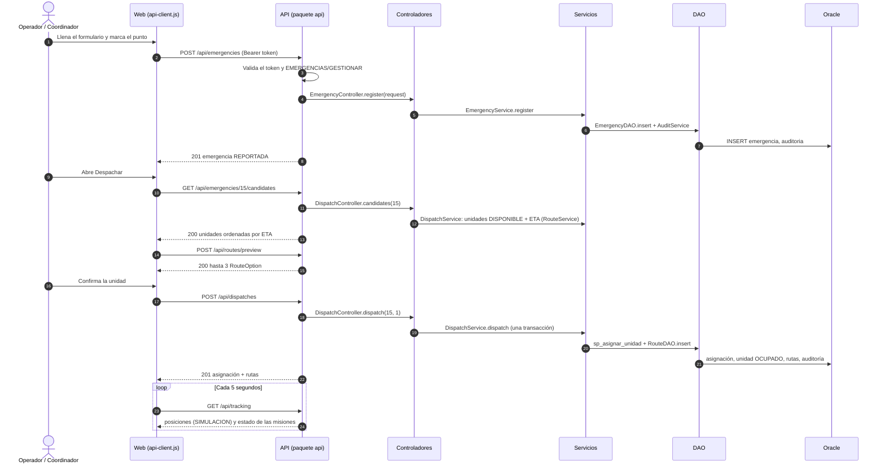

# Contrato de la API REST

Este documento define cada ruta de la API del núcleo de RutaVida: método, URL, permiso, JSON de entrada, JSON de salida y errores. La web (`frontend/js/api-client.js`) programa contra este contrato, y el servidor (tarea A12) lo implementa. **Nadie programa una ruta que no esté aquí**: si hace falta una nueva o un cambio, se actualiza este documento en un PR y lo aprueba el equipo.

| Dato | Valor |
|---|---|
| Estado | **Aprobado por el equipo** el 05/11/2026 (A10), con las decisiones DT-06, DT-07 y DT-08 de `docs/decisiones-tecnicas.md` |
| Revisan | Diego (consume la API) y Sherly (controladores) |
| Casos de uso | `docs/analysis.md`, sección 3 |
| Permisos | Tabla `PERMISO` (`database/02_datos_iniciales.sql`) |

**Todos los JSON de este documento son de EJEMPLO.** Los ids, las horas y los valores no salen de Oracle. Sirven para que la web pruebe sus pantallas antes de que exista el servidor.

## 1. Convenciones

| Tema | Regla |
|---|---|
| Dirección | `http://localhost:8080/api/...`. El mismo servidor entrega las páginas de `frontend/` (DT-06), así que la web llama con rutas relativas (`/api/emergencies`) y no hace falta CORS |
| URLs | En inglés, en plural y en minúsculas con guiones: `/api/emergency-types`. Los ids van en la ruta: `/api/emergencies/15` |
| Formato | JSON en UTF-8, en la petición y en la respuesta (`Content-Type: application/json`) |
| Nombres de los campos | En inglés y en *camelCase*, iguales a los getters de las clases del modelo y de los DTO: `addressReference`, `reportedAt`, `operationalStatus` |
| Estados y catálogos | Viajan con su **código en español**, el mismo de Oracle: `"REPORTADA"`, `"CRITICA"`, `"DISPONIBLE"`, `"PRINCIPAL"`. Nunca el nombre del enum en Java (`REPORTED`) |
| Fechas y horas | Texto ISO-8601 sin zona, en hora de Colombia: `"2026-11-04T09:30:15"`. Un valor sin dato es `null` |
| Coordenadas | Siempre un objeto: `{"latitude": 10.467172, "longitude": -73.265099}`, con 6 decimales. También dentro de las listas (el trazado de una ruta es una lista de estos objetos) |
| Números | Distancias en km (`distanceKm`), tiempos en minutos (`estimatedMinutes`, `etaMinutes`), con decimales |
| Datos simulados | Todo lo que viene del simulador lleva `"source": "SIMULACION"`, y la web lo rotula así. Nunca se muestra como GPS ni como tráfico real |
| Contraseñas | Ninguna respuesta incluye `passwordHash` ni la contraseña |

### 1.1 Forma de todas las respuestas

Todas las respuestas, con éxito o con error, tienen la misma forma que `OperationResult`:

```json
{ "success": true, "message": null, "value": { "id": 15 } }
```

```json
{ "success": false, "message": "La latitud debe estar entre -90 y 90.", "value": null }
```

- `value` es lo que pide la ruta: un objeto, una lista o `null` cuando la operación no devuelve nada.
- `message` es el texto en español para el usuario. La web lo muestra tal cual y **nunca** muestra detalles técnicos.

### 1.2 Códigos HTTP y errores

| Código | Cuándo | De dónde sale el mensaje |
|---|---|---|
| `200` | Consulta o cambio correcto | — |
| `201` | Se creó algo (emergencia, despacho, incidente) | — |
| `400` | Datos inválidos: falta un campo, una coordenada fuera de rango, un JSON mal escrito | `ValidationException` |
| `401` | Sin sesión, token inválido o vencido | `"Debe iniciar sesión."` (`Messages.SESSION_REQUIRED`) |
| `403` | Con sesión, pero el rol no tiene el permiso de la ruta | `AccessDeniedException` |
| `404` | El id de la ruta no existe | `"No se encontró la información solicitada."` (`Messages.NOT_FOUND`) |
| `409` | Se rompe una regla de negocio: transición de estado no permitida, unidad ocupada | `BusinessRuleException` |
| `503` | Oracle no responde | `"No hay conexión con la base de datos."` (`Messages.DATABASE_DOWN`) |
| `500` | Cualquier otro error | `"Ocurrió un error inesperado. Intente de nuevo."` (`Messages.UNEXPECTED`) |

El servidor registra el detalle técnico en el log, nunca en la respuesta.

## 2. Seguridad (DT-08)

1. La web inicia sesión con `POST /api/auth/login` y recibe un `token`.
2. La web guarda el token en `sessionStorage` (se borra al cerrar la pestaña) y lo envía en **todas** las demás peticiones:

   ```
   Authorization: Bearer 3f9c2a…
   ```

3. El token es un valor aleatorio de 32 bytes (`SecureRandom`) que el servidor guarda en memoria junto con la sesión (`UserSession`). Deja de servir en el primero de estos casos:
   - **30 minutos sin uso.** Cada petición del usuario reinicia el contador, **excepto** las consultas automáticas del mapa (`GET /api/tracking`, `GET /api/traffic/segments` y `GET /api/alerts`): si las contara, una pestaña abierta nunca vencería.
   - **8 horas** desde el inicio de sesión (un turno), aunque el usuario siga activo.
   - `POST /api/auth/logout`.

   Si el servidor se reinicia, todos tienen que volver a iniciar sesión.
4. Cada ruta exige el permiso de la columna **Permiso** (módulo y acción de la tabla `PERMISO`). El servidor lo revisa con `AuthService.requirePermission` antes de llamar al controlador. Que la web oculte un botón no reemplaza esta revisión.
5. Las únicas rutas sin token son `POST /api/auth/login` y las páginas de `frontend/`.

## 3. Resumen de rutas

| # | Método | URL | Permiso | Caso de uso |
|---|---|---|---|---|
| 1 | `POST` | `/api/auth/login` | Ninguno | CU-01 |
| 2 | `POST` | `/api/auth/logout` | Sesión | CU-02 |
| 3 | `GET` | `/api/auth/session` | Sesión | CU-01 |
| 4 | `GET` | `/api/emergency-types` | `EMERGENCIAS/CONSULTAR` | CU-06 |
| 5 | `GET` | `/api/emergencies` | `EMERGENCIAS/CONSULTAR` | CU-07 |
| 6 | `POST` | `/api/emergencies` | `EMERGENCIAS/GESTIONAR` | CU-06 |
| 7 | `GET` | `/api/emergencies/{id}` | `EMERGENCIAS/CONSULTAR` | CU-07 |
| 8 | `GET` | `/api/emergencies/{id}/history` | `EMERGENCIAS/CONSULTAR` | CU-15 |
| 9 | `GET` | `/api/emergencies/{id}/candidates` | `DESPACHO/GESTIONAR` | CU-09 |
| 10 | `POST` | `/api/routes/preview` | `RUTAS/GESTIONAR` | CU-08 |
| 11 | `POST` | `/api/dispatches` | `DESPACHO/GESTIONAR` | CU-09 |
| 12 | `GET` | `/api/dispatches/{id}/routes` | `RUTAS/CONSULTAR` | CU-08, CU-17 |
| 13 | `GET` | `/api/dispatches/{id}/hospitals` | `DESPACHO/GESTIONAR` | CU-11 |
| 14 | `PATCH` | `/api/dispatches/{id}/status` | `DESPACHO/GESTIONAR` | CU-10, CU-11 |
| 15 | `POST` | `/api/emergencies/{id}/close` | `DESPACHO/GESTIONAR` | CU-12 |
| 16 | `GET` | `/api/vehicle-types` | `UNIDADES/CONSULTAR` | CU-04 |
| 17 | `GET` | `/api/units` | `UNIDADES/CONSULTAR` | CU-07 |
| 18 | `GET` | `/api/stations` | `UNIDADES/CONSULTAR` | CU-07 |
| 19 | `GET` | `/api/hospitals` | `HOSPITALES/CONSULTAR` | CU-07, CU-11 |
| 20 | `GET` | `/api/tracking` | `EMERGENCIAS/CONSULTAR` | CU-07, CU-18 |
| 21 | `GET` | `/api/traffic/segments` | `TRAFICO/CONSULTAR` | CU-07 |
| 22 | `GET` | `/api/incidents` | `INCIDENTES/CONSULTAR` | CU-07 |
| 23 | `POST` | `/api/incidents` | `INCIDENTES/GESTIONAR` | CU-13 |
| 24 | `PATCH` | `/api/incidents/{id}/status` | `INCIDENTES/GESTIONAR` | CU-14 |
| 25 | `GET` | `/api/simulation` | `TRAFICO/CONSULTAR` | CU-19 |
| 26 | `POST` | `/api/simulation/start` | `TRAFICO/GESTIONAR` | CU-19 |
| 27 | `POST` | `/api/simulation/stop` | `TRAFICO/GESTIONAR` | CU-19 |
| 28 | `POST` | `/api/simulation/traffic` | `TRAFICO/GESTIONAR` | CU-19 |
| 29 | `GET` | `/api/dashboard/summary` | `REPORTES/CONSULTAR` | CU-16 |
| 30 | `GET` | `/api/alerts` | Sesión | RF de alertas |
| 31 | `PATCH` | `/api/alerts/{id}/read` | Sesión | RF de alertas |

"Sesión" significa que basta con un token válido, sin un permiso específico.

## 4. Sesión

### 4.1 `POST /api/auth/login`

Entrada:

```json
{ "username": "operador1", "password": "texto-que-escribe-el-usuario" }
```

Salida `200`:

```json
{
  "success": true,
  "message": null,
  "value": {
    "token": "3f9c2a7e0b5d4c18a6e2f9d1b7c4a0e53f9c2a7e0b5d4c18a6e2f9d1b7c4a0e5",
    "expiresAt": "2026-11-04T17:30:00",
    "idleTimeoutMinutes": 30,
    "user": { "id": 3, "username": "operador1", "firstNames": "Ana", "lastNames": "Pérez" },
    "role": "OPERADOR_CENTRAL",
    "permissions": ["EMERGENCIAS:CONSULTAR", "EMERGENCIAS:GESTIONAR", "RUTAS:GESTIONAR"]
  }
}
```

Errores (mensajes de `AuthService`): `400` con `"Escriba el usuario y la contraseña."`; `401` con `"Usuario o contraseña incorrectos"`, el mismo para un usuario que no existe y para una contraseña errada, para no revelar cuál falló; `401` con `"El usuario está inactivo"`. En esta ruta, los errores de credenciales son `401` aunque `AuthService` los lance como `BusinessRuleException`.

`expiresAt` es el límite de 8 horas; `idleTimeoutMinutes` es el límite por inactividad. La web usa `permissions` solo para mostrar u ocultar botones.

### 4.2 `POST /api/auth/logout`

Sin cuerpo. Invalida el token. Salida `200` con `value: null`. Si el token ya no era válido, responde igual `200`.

### 4.3 `GET /api/auth/session`

Devuelve el mismo `value` del login, sin `token`. La web lo llama al abrir una página para saber si la sesión sigue viva; si recibe `401`, vuelve a `index.html`.

## 5. Emergencias

### 5.1 `GET /api/emergency-types`

```json
{ "success": true, "message": null, "value": [
  { "id": 1, "name": "EMERGENCIA_MEDICA", "priority": 9, "description": "Urgencia medica sin accidente de transito" },
  { "id": 3, "name": "ACCIDENTE_VIAL", "priority": 8, "description": "Accidente de transito con posibles lesionados" }
] }
```

Ordenados de mayor a menor prioridad (`EmergencyTypeDAO.findAll`).

### 5.2 `GET /api/emergencies`

Las emergencias que no están `CERRADA`, la más reciente primero (`EmergencyDAO.findActive`). Cada una es la entidad `Emergency`:

```json
{ "success": true, "message": null, "value": [
  {
    "id": 15,
    "emergencyTypeId": 3,
    "reportedByUserId": 3,
    "addressReference": "Frente al Parque La Popa",
    "location": { "latitude": 10.467172, "longitude": -73.265099 },
    "reportedAt": "2026-11-04T09:30:15",
    "severity": "CRITICA",
    "description": "Choque entre dos vehículos",
    "status": "REPORTADA",
    "closedAt": null
  }
] }
```

El nombre del tipo se toma del catálogo (5.1) con `emergencyTypeId`.

### 5.3 `POST /api/emergencies`

Registra una emergencia (CU-06). Entrada, igual al DTO `EmergencyRequest`:

```json
{
  "emergencyTypeId": 3,
  "addressReference": "Frente al Parque La Popa",
  "location": { "latitude": 10.467172, "longitude": -73.265099 },
  "severity": "CRITICA",
  "description": "Choque entre dos vehículos"
}
```

- `description` es opcional (`null` o se omite).
- El servidor pone `reportedAt` (su reloj), `reportedByUserId` (el usuario del token) y `status` = `REPORTADA`. Si la web los envía, se ignoran.

Salida `201`: la emergencia creada, con su `id` (misma forma de 5.2).

Errores `400`: tipo inexistente, dirección vacía, coordenadas fuera de rango, severidad desconocida.

### 5.4 `GET /api/emergencies/{id}`

Una emergencia, con la forma de 5.2. `404` si no existe.

### 5.5 `GET /api/emergencies/{id}/history`

Todo lo que pasó con una emergencia (CU-15), igual al DTO `EmergencyHistory`:

```json
{ "success": true, "message": null, "value": {
  "emergency": { "id": 15, "status": "CERRADA", "...": "misma forma de 5.2" },
  "assignments": [
    { "id": 8, "emergencyId": 15, "vehicleId": 1, "coordinatorUserId": 4,
      "assignedAt": "2026-11-04T09:32:00", "departedAt": "2026-11-04T09:33:10",
      "arrivedAt": "2026-11-04T09:41:45", "status": "FINALIZADA" }
  ],
  "routes": [
    { "id": 30, "emergencyId": 15, "vehicleId": 1, "destinationHospitalId": null,
      "type": "PRINCIPAL", "distanceKm": 2.84, "estimatedMinutes": 6.9, "totalCost": 414.0,
      "generatedAt": "2026-11-04T09:32:00", "recommended": true, "status": "FINALIZADA" }
  ],
  "auditTrail": [
    { "id": 101, "userId": 3, "module": "EMERGENCIAS", "operation": "REGISTRAR", "recordId": 15,
      "occurredAt": "2026-11-04T09:30:15", "result": "EXITO", "detail": "Emergencia registrada" },
    { "id": 102, "userId": 4, "module": "EMERGENCIAS", "operation": "CAMBIO_ESTADO", "recordId": 15,
      "occurredAt": "2026-11-04T09:32:00", "result": "EXITO", "detail": "REPORTADA -> ASIGNADA" }
  ]
} }
```

Las rutas del historial no traen el trazado: el historial es para leer, no para dibujar. Los tramos de cada ruta no se incluyen.

## 6. Despacho y rutas

### 6.1 `GET /api/emergencies/{id}/candidates`

Las unidades que pueden atender la emergencia (CU-09, paso 2): solo `DISPONIBLE` y de un tipo adecuado para la emergencia (regla de `DispatchService` que se define en K7). Ordenadas por tiempo estimado de llegada, la más rápida primero:

```json
{ "success": true, "message": null, "value": [
  { "vehicleId": 1, "unitCode": "EJEMPLO-AMB-01", "vehicleType": "AMBULANCIA",
    "stationName": "EJEMPLO - Base de ambulancias",
    "location": { "latitude": 10.469330, "longitude": -73.254520 },
    "etaMinutes": 6.9, "distanceKm": 2.84 },
  { "vehicleId": 2, "unitCode": "EJEMPLO-AMB-02", "vehicleType": "AMBULANCIA",
    "stationName": "EJEMPLO - Base de ambulancias",
    "location": { "latitude": 10.469330, "longitude": -73.254520 },
    "etaMinutes": 6.9, "distanceKm": 2.84 }
] }
```

Lista vacía si no hay unidades disponibles (la web muestra "No hay unidades disponibles"). `409` si la emergencia no está `REPORTADA`.

### 6.2 `POST /api/routes/preview`

Calcula las rutas de una unidad hasta la emergencia **sin guardar nada** (CU-08). La web las dibuja antes de que el coordinador confirme.

Entrada:

```json
{ "emergencyId": 15, "vehicleId": 1 }
```

Salida `200`: hasta 3 objetos `RouteOption`, la recomendada primero:

```json
{ "success": true, "message": null, "value": [
  {
    "rank": 1,
    "type": "PRINCIPAL",
    "path": [
      { "latitude": 10.469330, "longitude": -73.254520 },
      { "latitude": 10.468901, "longitude": -73.258004 },
      { "latitude": 10.467172, "longitude": -73.265099 }
    ],
    "segmentIds": [412, 413, 977],
    "distanceKm": 2.84,
    "estimatedMinutes": 6.9,
    "trafficLights": 2,
    "congestedSegments": 0,
    "explanation": "Ruta recomendada: 2,8 km en 6,9 min, con 2 semáforos y sin tramos congestionados."
  }
] }
```

- Puede traer 1, 2 o 3 rutas. Si son menos de 3, la `explanation` de la última dice por qué no hay más.
- `409` con `"No hay ruta disponible con las condiciones actuales."` si no existe camino.
- `400` si la emergencia o la unidad están fuera de la zona de la red vial.

### 6.3 `POST /api/dispatches`

Despacha la unidad (CU-09). En **una transacción**: crea la asignación, pasa la emergencia a `ASIGNADA` y la unidad a `OCUPADO`, guarda la ruta principal como `ACTIVA` y las alternativas como `PROPUESTA`, y audita. Después el simulador empieza a mover la unidad.

Entrada:

```json
{ "emergencyId": 15, "vehicleId": 1 }
```

Salida `201`:

```json
{ "success": true, "message": null, "value": {
  "assignment": { "id": 8, "emergencyId": 15, "vehicleId": 1, "coordinatorUserId": 4,
                  "assignedAt": "2026-11-04T09:32:00", "departedAt": null,
                  "arrivedAt": null, "status": "ASIGNADA" },
  "routes": [ { "routeId": 30, "status": "ACTIVA", "rank": 1, "...": "misma forma de 6.4" } ]
} }
```

Errores `409`: la emergencia no está `REPORTADA`; la unidad no está `DISPONIBLE` (por ejemplo, otro coordinador la asignó un instante antes); no hay ruta.

Las rutas se calculan otra vez al despachar: pueden ser distintas de la vista previa si el tráfico cambió en ese tiempo.

### 6.4 `GET /api/dispatches/{id}/routes`

Las rutas vigentes de una misión (`id` = id de la asignación): la `ACTIVA` y las `PROPUESTA`. Es la forma de `RouteOption` más el id y el estado guardados en Oracle (DTO `MissionRoute`, nuevo en A12):

```json
{ "success": true, "message": null, "value": [
  { "routeId": 30, "status": "ACTIVA", "recommended": true, "destinationHospitalId": null,
    "rank": 1, "type": "PRINCIPAL", "path": [ { "latitude": 10.469330, "longitude": -73.254520 } ],
    "segmentIds": [412, 413, 977], "distanceKm": 2.84, "estimatedMinutes": 6.9,
    "trafficLights": 2, "congestedSegments": 0,
    "explanation": "Ruta recomendada: 2,8 km en 6,9 min, con 2 semáforos y sin tramos congestionados." }
] }
```

La web vuelve a pedir esta ruta cuando `/api/tracking` indica que cambió `routesVersion` de la misión (recálculo, CU-17).

### 6.5 `GET /api/dispatches/{id}/hospitals`

Hospitales operativos para el traslado (CU-11), el más conveniente primero:

```json
{ "success": true, "message": null, "value": [
  { "hospitalId": 1, "name": "HOSPITAL ROSARIO PUMAREJO DE LOPEZ", "level": "II",
    "location": { "latitude": 10.469330, "longitude": -73.254520 },
    "etaMinutes": 4.2, "distanceKm": 1.65 }
] }
```

`409` si la misión no está `EN_SITIO`.

### 6.6 `PATCH /api/dispatches/{id}/status`

Avanza la misión (CU-10). Transiciones permitidas, las mismas de `DispatchService`: `ASIGNADA → EN_RUTA → EN_SITIO → TRASLADANDO → FINALIZADA`, `EN_SITIO → FINALIZADA` (sin traslado), y `CANCELADA` desde `ASIGNADA` o `EN_RUTA`.

Entrada:

```json
{ "status": "EN_RUTA" }
```

Para pasar a `TRASLADANDO` se envía también el hospital (CU-11):

```json
{ "status": "TRASLADANDO", "hospitalId": 1 }
```

Salida `200`: la asignación actualizada (forma de 6.3). Con `TRASLADANDO`, el servidor calcula y guarda las rutas al hospital, y la web las lee con 6.4.

Errores: `409` con `"No se puede cambiar la asignación de ASIGNADA a TRASLADANDO."` si la transición no está permitida; `400` si falta `hospitalId` al pasar a `TRASLADANDO`.

La llegada al sitio (`EN_SITIO`) también la puede marcar el simulador por su cuenta.

### 6.7 `POST /api/emergencies/{id}/close`

Cierra la emergencia (CU-12) con `sp_cerrar_emergencia`: finaliza las asignaciones abiertas, libera las unidades (`DISPONIBLE`) y cierra las rutas. Sin cuerpo. Salida `200`: la emergencia con `status` = `CERRADA` y `closedAt`. `409` si ya estaba cerrada.

## 7. Recursos: unidades, estaciones y hospitales

### 7.1 `GET /api/vehicle-types`

```json
{ "success": true, "message": null, "value": [
  { "id": 1, "name": "AMBULANCIA", "priority": 8, "description": "Unidad de atencion medica y traslado" },
  { "id": 2, "name": "BOMBERO", "priority": 8, "description": "Vehiculo del cuerpo de bomberos" }
] }
```

### 7.2 `GET /api/units`

Todas las unidades (`EmergencyVehicleDAO.findAll`), con la entidad `EmergencyVehicle`:

```json
{ "success": true, "message": null, "value": [
  { "id": 1, "vehicleTypeId": 1, "stationId": 2, "unitCode": "EJEMPLO-AMB-01", "plate": null,
    "operationalStatus": "DISPONIBLE",
    "lastLocation": { "latitude": 10.469330, "longitude": -73.254520 },
    "lastLocationAt": "2026-11-04T08:00:00" }
] }
```

`lastLocation` y `lastLocationAt` son `null` si la unidad todavía no tiene posición. Las unidades `EJEMPLO-…` son de ejemplo (`database/06_unidades_ejemplo.sql`) y la web las rotula así.

### 7.3 `GET /api/stations`

Entidad `EmergencyStation`: `id`, `name`, `address`, `neighborhood`, `phone`, `location`, `status` (`"A"` o `"I"`).

### 7.4 `GET /api/hospitals`

Los hospitales activos (`HospitalDAO.findOperational`). Con `?all=true` también los inactivos (`findAll`). Entidad `Hospital`: `id`, `name`, `level` (`"I"` a `"IV"`), `address`, `phone`, `location`, `emergencyCapacity` (puede ser `null`: dato no verificado), `status`.

## 8. Seguimiento en tiempo real (DT-07)

### 8.1 `GET /api/tracking`

La web lo consulta **cada 5 segundos** (DT-07) mientras la página del mapa está abierta, y anima el marcador de cada unidad entre la posición anterior y la nueva para que no salte. Devuelve una foto completa del estado, no solo los cambios, para que la web no tenga que acumular nada:

```json
{ "success": true, "message": null, "value": {
  "serverTime": "2026-11-04T09:35:02",
  "simulation": { "running": true, "source": "SIMULACION" },
  "units": [
    { "vehicleId": 1, "unitCode": "EJEMPLO-AMB-01", "vehicleType": "AMBULANCIA",
      "operationalStatus": "OCUPADO",
      "location": { "latitude": 10.468901, "longitude": -73.258004 },
      "updatedAt": "2026-11-04T09:35:01", "source": "SIMULACION" }
  ],
  "missions": [
    { "assignmentId": 8, "emergencyId": 15, "vehicleId": 1, "status": "EN_RUTA",
      "activeRouteId": 30, "routesVersion": 2 }
  ],
  "unreadAlerts": 1
} }
```

- `routesVersion` sube cada vez que el sistema recalcula las rutas de esa misión (CU-17). Si la web ve un número distinto al que tenía, pide `GET /api/dispatches/{id}/routes` y redibuja.
- `unreadAlerts` permite mostrar el contador sin pedir la lista cada 5 segundos.
- `source` es `"SIMULACION"` mientras no exista GPS real (`PositionSource`).

### 8.2 `GET /api/traffic/segments`

Los tramos con tráfico `MODERADO` o `CONGESTIONADO` (la última medición de cada uno), para pintarlos en el mapa. Con `?level=CONGESTIONADO`, solo esos.

```json
{ "success": true, "message": null, "value": [
  { "segmentId": 413, "streetName": "Calle 16", "level": "CONGESTIONADO", "congestionFactor": 2.6,
    "measuredAt": "2026-11-04T09:34:50", "source": "SIMULACION",
    "from": { "latitude": 10.468901, "longitude": -73.258004 },
    "to": { "latitude": 10.468377, "longitude": -73.260112 } }
] }
```

La web los consulta **cada 15 segundos** (DT-07): cambian menos que las posiciones.

## 9. Incidentes viales

### 9.1 `GET /api/incidents`

Los incidentes `PENDIENTE` y `ACTIVO`. Con `?status=ACTIVO`, solo esos. Es la entidad `RoadIncident` más el tramo para dibujarlo:

```json
{ "success": true, "message": null, "value": [
  { "id": 4, "segmentId": 413, "type": "ACCIDENTE", "severity": "ALTA", "blocksSegment": false,
    "description": "Choque en la Calle 16", "startedAt": "2026-11-04T09:34:00", "endedAt": null,
    "status": "PENDIENTE", "origin": "OPERADOR",
    "segment": { "streetName": "Calle 16",
      "from": { "latitude": 10.468901, "longitude": -73.258004 },
      "to": { "latitude": 10.468377, "longitude": -73.260112 } } }
] }
```

### 9.2 `POST /api/incidents`

Registra un incidente (CU-13). Entra `PENDIENTE` y **no afecta las rutas** hasta que alguien lo activa (9.3).

```json
{ "segmentId": 413, "type": "ACCIDENTE", "severity": "ALTA", "blocksSegment": false,
  "description": "Choque en la Calle 16" }
```

Salida `201`: el incidente (forma de 9.1). `400` si el tramo no existe o el tipo o la severidad no son válidos.

### 9.3 `PATCH /api/incidents/{id}/status`

Valida o cierra un incidente (CU-14): `{ "status": "ACTIVO" }`, `{ "status": "RECHAZADO" }` o `{ "status": "CERRADO" }`. Al pasar a `ACTIVO` o `CERRADO`, el motor de rutas lo tiene en cuenta y se revisan las rutas activas (CU-17). Salida `200`: el incidente. `409` si la transición no está permitida (`IncidentService`).

## 10. Simulación (CU-19)

### 10.1 `GET /api/simulation`

```json
{ "success": true, "message": null, "value": {
  "running": true, "startedAt": "2026-11-04T09:31:00", "tickSeconds": 1, "source": "SIMULACION" } }
```

### 10.2 `POST /api/simulation/start` y `POST /api/simulation/stop`

Sin cuerpo. Inician o detienen el simulador. Salida `200`: el estado de 10.1. Iniciar uno que ya corre (o detener uno detenido) no es error: responde el estado actual.

### 10.3 `POST /api/simulation/traffic`

Fuerza el nivel de tráfico de un tramo, para mostrar el recálculo en la demostración. Se guarda en `TRAFICO` con fuente `SIMULACION`.

```json
{ "segmentId": 413, "level": "CONGESTIONADO" }
```

Salida `200`: el tramo con la forma de 8.2. `404` si el tramo no existe.

## 11. Dashboard y alertas

### 11.1 `GET /api/dashboard/summary`

```json
{ "success": true, "message": null, "value": {
  "activeEmergencies": 3, "availableUnits": 3, "busyUnits": 1, "operationalHospitals": 2,
  "activeIncidents": 1, "congestedSegments": 4, "closedToday": 2,
  "averageResponseMinutes": 9.4
} }
```

Qué cuenta cada campo (A14, una sola consulta en Oracle):

| Campo | Qué cuenta |
|---|---|
| `activeEmergencies` | Emergencias que no están `CERRADA` (`vw_emergencias_activas`) |
| `availableUnits` / `busyUnits` | Unidades `DISPONIBLE` (`vw_unidades_disponibles`) / `OCUPADO`. Las de `MANTENIMIENTO` o `FUERA_SERVICIO` no están en ninguna |
| `operationalHospitals` | Hospitales activos (`vw_hospitales_operativos`) |
| `activeIncidents` | Incidentes `ACTIVO`, los que cambian las rutas. Los `PENDIENTE` no cuentan |
| `congestedSegments` | Tramos cuya última lectura de `TRAFICO` de los últimos 15 minutos es `CONGESTIONADO` |
| `closedToday` | Emergencias `CERRADA` hoy, de 00:00 a 24:00 en la hora del servidor (Colombia) |
| `averageResponseMinutes` | Promedio de `fn_tiempo_respuesta` (reporte → llegada) de las emergencias con una llegada hoy, contando solo la primera unidad que llegó a cada una. Un decimal |

`averageResponseMinutes` es `null` si hoy no ha llegado ninguna unidad. La web muestra "Sin datos" en ese caso, nunca un 0. Se mide por la llegada y no por el cierre para que el indicador funcione desde el despacho (K7), antes de que exista el cierre (CU-12).

El panel puede pedir este resumen solo cada cierto tiempo: esa consulta no cuenta como uso de la sesión (DT-08).

### 11.2 `GET /api/alerts`

Las alertas del usuario de la sesión, la más reciente primero. Con `?unread=true`, solo las no leídas.

```json
{ "success": true, "message": null, "value": [
  { "id": 21, "emergencyId": 15, "type": "RECALCULO_RUTA",
    "message": "Se recalculó la ruta de EJEMPLO-AMB-01 por congestión en la Calle 16.",
    "createdAt": "2026-11-04T09:35:00", "read": false }
] }
```

### 11.3 `PATCH /api/alerts/{id}/read`

Sin cuerpo. Marca la alerta como leída. `404` si no existe o es de otro usuario.

## 12. Secuencia: registrar y despachar



## 13. Fuera de este contrato

- **Botón de pánico, rol Policía y patrullas de policía simuladas** (DT-10): tienen sus propias rutas, que se agregan a este documento en su tarea. La ruta del botón será la única sin sesión.
- **Administración** (CU-03, CU-04, CU-05, CU-21): crear y editar usuarios, unidades, estaciones y hospitales, y consultar la auditoría. Los DAO ya tienen `insert` y `update`; las rutas se agregan cuando se programen esas pantallas.
- **Reporte ciudadano por QR** (CU-22): fuera del alcance de la primera versión.

## 14. Notas para quien implementa (A12)

- Los enums se convierten a JSON con su `code()` y se leen con `fromCode` (por ejemplo, un módulo de Jackson que lo haga para todo `CodedEnum`). El modelo no se anota: no puede depender de la librería de JSON.
- `User` nunca se serializa directo: el login devuelve un DTO sin `passwordHash`.
- Cada ruta llama a un controlador y convierte su `OperationResult` en la respuesta. El código HTTP sale del tipo de error (sección 1.2), así que el controlador necesita entregar también el tipo, no solo el mensaje.
- DTO nuevos que nombra este contrato: `LoginResponse`, `UnitCandidate`, `MissionRoute`, `HospitalOption`, `TrackingSnapshot`, `DashboardSummary`. Se agregan al diagrama de clases cuando se programen.
