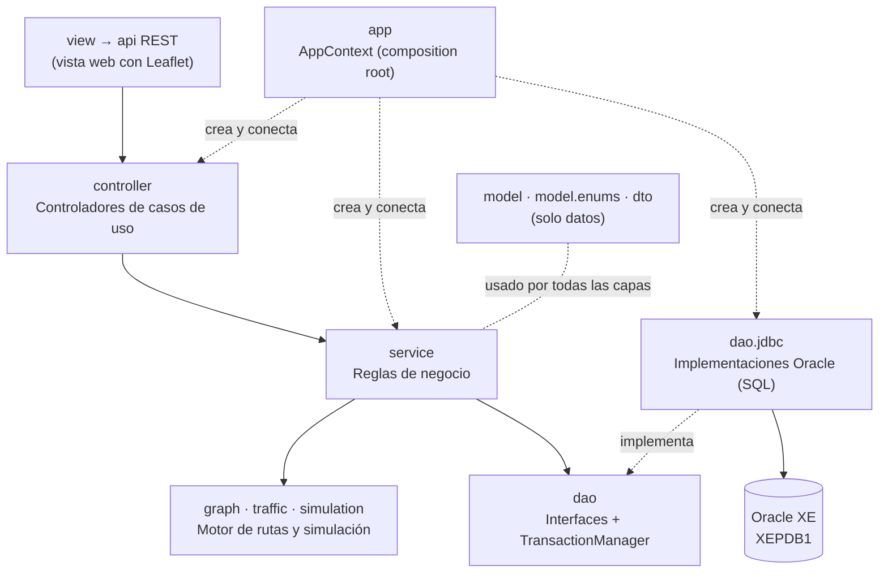
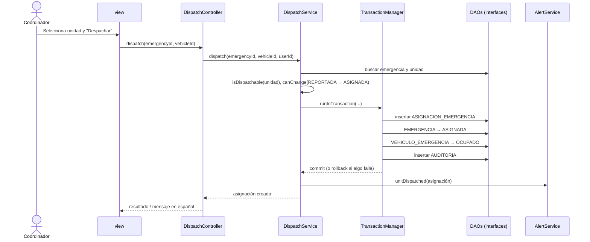

# Arquitectura de software — RutaVida (backend Java)

Responsable: Andrés (líder, DAO e integración).
Fecha: 14 de octubre de 2026 · actualizado el 30 de octubre de 2026 (refactorización de capas).
Estado: **capas, modelo, DAO principales, motor de rutas y reglas de estado programados y probados**; despacho completo, simulación y API REST pendientes (sección 10).

Paquete raíz: `co.edu.unicesar.rutavida` · Java 21 · Maven · Oracle XE local (`XEPDB1`).

---

## 1. Idea general

RutaVida usa una **arquitectura en capas** con cuatro decisiones que la hacen defendible:

1. **Las capas superiores dependen de interfaces, no de implementaciones.** Un servicio conoce `EmergencyDAO`, no `JdbcEmergencyDAO`. La única clase que conecta interfaces con implementaciones es `app.AppContext` (*composition root*, inyección de dependencias manual, sin framework).
2. **Cada capa tiene una sola responsabilidad.** El modelo solo guarda datos; las reglas de negocio (validaciones, transiciones de estado) están **solo** en `service`; el DAO solo traduce entre filas y objetos. Así cada regla está en un único lugar y se depura en un único lugar.
3. **El tiempo real se resuelve con llamadas directas.** El simulador llama a `RoadConditionService` y luego a `RouteMonitor`; nadie llama directamente a la vista, que recibe el estado por la API REST. (Un bus de eventos se programó al inicio, pero ninguna clase lo usaba y se eliminó para simplificar.)
4. **Las reglas se verifican con pruebas.** `ArchitectureTest` falla si alguien rompe una regla de dependencia, y `EnumSqlContractTest` falla si los estados de Java y los CHECK de Oracle dejan de coincidir.



---

## 2. Paquetes

| Paquete | Capa | Responsabilidad | Dueño |
|---|---|---|---|
| `app` | Arranque | `AppContext`: crea los objetos y les inyecta sus dependencias. Puntos de entrada | Andrés |
| `model` | Model | Entidades, una por tabla, con nombres en inglés (`Emergency`, `RoadSegment`…). **Solo datos:** atributos, constructor, getters y setters; sin validaciones ni reglas | Sherly |
| `model.enums` | Model | Estados y catálogos. Cada constante en inglés guarda su código en español de Oracle (`code()` / `fromCode()`); sin reglas | Sherly (códigos: Andrés) |
| `dto` | Model | Objetos de transferencia (records) entre el controlador y la vista: opción de ruta con explicación, resumen del dashboard | Sherly |
| `dao` | DAO | **Interfaces** de persistencia (una por agregado) y `TransactionManager`. Sin tipos JDBC | Andrés |
| `dao.jdbc` | DAO | Implementaciones con JDBC y SQL de Oracle, transacciones, mapeo fila → objeto | Andrés |
| `service` | Service | **Todas** las reglas de negocio: validar datos, transiciones de estado, permisos; coordinar DAOs en una transacción | Kendrick (rutas, despacho, seguimiento) · Sherly (usuarios, hospitales, alertas, auditoría) |
| `graph` | Service | Motor de rutas en memoria: grafo, función de costo, A*/Dijkstra, rutas alternativas | Kendrick |
| `traffic` | Service | Fuentes de tráfico detrás de `TrafficProvider`: simulador (fase 1) y fuente externa (fase 2) | Kendrick |
| `simulation` | Service | Ciclo de tiempo real, movimiento simulado de unidades y escenarios de demostración | Kendrick |
| `controller` | Controller | Controladores de casos de uso: reciben la acción del usuario y delegan en los servicios | Sherly |
| `view` | View | Interfaz de usuario. **Decidido: web** (DT-01); en el backend este paquete pasará a ser `api` (adaptadores REST) y la página web irá en `frontend/` | Diego (página web), Andrés y Sherly (`api`) |
| `util` | Util | Ayudas técnicas sin reglas de negocio: conexión, `PasswordHasher`, `ValidationUtil` (la usan los servicios), `GeoUtil` (distancias) y `Messages` | Sherly (`DatabaseConnection`: Andrés) |
| `osm` | Herramienta | Importador de OpenStreetMap: lee el `.osm` y escribe el SQL de la red vial. No forma parte de la aplicación final | Kendrick |
| `exception` | Transversal | Jerarquía de excepciones compartida | Andrés |

Cada paquete tiene un `package-info.java` con su responsabilidad, sus dependencias permitidas y su dueño. En IntelliJ se ven con *Ctrl+Q* sobre el nombre del paquete.

---

## 3. Reglas de dependencia (verificadas por `ArchitectureTest`)

| Paquete | **No** puede importar |
|---|---|
| `model`, `model.enums` | `java.sql`, Swing/AWT, `dao`, `service`, `controller`, `view`, `graph`, `traffic`, `simulation`, `app`, **`exception`, `util`** (así el modelo no puede validar) |
| `dao` (interfaces) | `java.sql`, `javax.sql`, `oracle.*`, `dao.jdbc`, `service`, `controller`, `view` |
| `dao.jdbc` | Swing/AWT, `service`, `controller`, `view`, `simulation`, `app` |
| `service` | `java.sql`, `javax.sql`, `oracle.*`, Swing/AWT, `dao.jdbc`, `controller`, `view`, `app` |
| `graph`, `traffic` | JDBC, Swing/AWT, `dao`, `service`, `controller`, `view`, `simulation`, `app` |
| `osm` | JDBC, Swing/AWT, `dao`, `service`, `controller`, `view`, `graph`, `traffic`, `simulation`, `app` |
| `controller` | JDBC, Swing/AWT, `dao`, `view`, `app` |
| `view` | JDBC, `dao`, `service`, `graph`, `traffic`, `simulation` |
| Todos, salvo `dao.jdbc` y `app` | `dao.jdbc` |

En resumen: **la vista solo habla con controladores, los controladores solo con servicios, las reglas solo están en los servicios y solo los DAO hablan con Oracle.**

---

## 4. Cómo fluye un caso de uso: despachar una unidad



- **Transacción:** las cuatro escrituras se guardan juntas o no se guarda ninguna. Los DAOs no hacen `commit` ni `close`; de eso se encarga `JdbcTransactionManager`.
- **Reglas:** las dos comprobaciones las hace `DispatchService` con sus propios métodos; la entidad `EmergencyVehicle` solo entrega su estado.
- **Errores:** si una regla no se cumple, el servicio lanza `BusinessRuleException`; si falla Oracle, el DAO lanza `DataAccessException`. El controlador convierte ambas en un mensaje en español para el usuario.

## 5. Cómo fluye el tiempo real

```
SimulationEngine.tick()
   ├──► RoadConditionService.refreshTraffic() ──► TrafficProvider.poll() ──► actualiza el grafo
   │         └── devuelve los tramos que cambiaron
   └──► RouteMonitor.checkActiveRoutes(tramos) ──► recalcula las rutas ACTIVAS afectadas
                    └──► si mejora más del umbral: guarda la ruta nueva y llama a AlertService

La página web pide el estado a la API REST (rutas, posiciones, alertas) y redibuja el mapa.
```

- El historial (`TRAFICO`, `UBICACION_VEHICULO`) se guarda **por lotes**, no en cada tick.
- Son llamadas directas: con el depurador de IntelliJ se puede seguir paso a paso desde el *tick* hasta la alerta.
- Cómo llega el cambio al navegador (consultas periódicas o *Server-Sent Events*) está pendiente de decidir (`docs/decisiones-tecnicas.md`).

---

## 6. GRASP aplicado a RutaVida

| Patrón | Dónde se aplica | Estado |
|---|---|---|
| **Information Expert** | `EmergencyService` conoce las transiciones de una emergencia (`canChange`, `changeStatus`); `DispatchService` las de una asignación y qué unidad se puede despachar (`isDispatchable`); `IncidentService` cuándo un incidente afecta las rutas (`affectsRouting`). Cada servicio es el experto de su área | Programado y probado |
| **Information Expert** | `RoadGraph` conoce sus tramos y su estado; `AStarRouter` calcula el tiempo total de una ruta | Programado y probado |
| **Creator** | `DispatchService` crea la `EmergencyAssignment` (tiene la emergencia, la unidad y el usuario); `RouteService` crea las `Route` | Por programar |
| **Controller** | `LoginController`, `EmergencyController`, `DispatchController`… reciben las acciones del usuario que genera la vista | `LoginController` programado; los demás por programar |
| **Low Coupling** | La vista solo conoce controladores; los servicios solo interfaces DAO; el modelo no depende de ninguna otra capa | Reglas programadas y probadas (`ArchitectureTest`) |
| **High Cohesion** | Un servicio por área de negocio (`EmergencyService`, `DispatchService`, `IncidentService`…); un DAO por agregado; el modelo solo con datos | Programado |
| **Polymorphism** | `CostFunction` (`EmergencyCost`, `DistanceOnlyCost`), `TrafficProvider` (simulado o real) | Programado y probado |
| **Pure Fabrication** | `JdbcTransactionManager`, `AppContext`, `DatabaseConnection`, los DAOs, `GraphLoader`, `PasswordHasher` | Programado |
| **Indirection** | `TransactionManager` entre servicios y JDBC; los controladores entre vista y servicios | Programado |
| **Protected Variations** | Interfaces DAO (cambiar de Oracle local a la nube o a otra base), `TrafficProvider` (simulación → fuente real), `ConnectionFactory`, `Clock` | Programado en DAO y conexión |

## 7. SOLID aplicado a RutaVida

| Principio | Cómo se cumple | Ejemplo |
|---|---|---|
| **S** — Responsabilidad única | Cada clase tiene un solo motivo para cambiar: el SQL solo cambia en `dao.jdbc`, las reglas en `service`, los datos en `model`, los textos en `util` | `Emergency` solo guarda datos; `EmergencyService` decide si puede cambiar de estado; `JdbcEmergencyAssignmentDAO` solo la guarda |
| **O** — Abierto/cerrado | Se agregan comportamientos con clases nuevas sin modificar las existentes | Nueva `CostFunction` o nuevo `TrafficProvider` sin tocar `AStarRouter` |
| **L** — Sustitución de Liskov | Toda implementación respeta el contrato de su interfaz | Un `TrafficProvider` real o simulado nunca devuelve `null` y solo reporta tramos que existen; un DAO falso de prueba se comporta como el real |
| **I** — Segregación de interfaces | Interfaces pequeñas: no hay un `CrudDAO` genérico con métodos que no aplican | `TRAFICO`, `UBICACION_VEHICULO` y `AUDITORIA` son solo de inserción: sus DAOs no tienen `update` ni `delete` |
| **D** — Inversión de dependencias | Los módulos de alto nivel dependen de abstracciones y `AppContext` elige la implementación | `AuthService(UserDAO, RoleDAO, PasswordHasher, AuditService, Clock)`: recibe interfaces DAO y `AppContext` le entrega las implementaciones JDBC |

---

## 8. Convenciones de nombres

| Elemento | Convención | Ejemplo |
|---|---|---|
| Entidad | Sustantivo en inglés, singular (tabla V.4 del documento consolidado) | `Emergency`, `RoadSegment`, `EmergencyAssignment` |
| Enum de estado | `<Entidad>Status` o nombre del catálogo, implementa `CodedEnum` | `EmergencyStatus.EN_ROUTE` → `"EN_RUTA"` |
| Interfaz DAO | `<Entidad>DAO` | `EmergencyDAO` |
| Implementación DAO | `Jdbc<Entidad>DAO` en `dao.jdbc` | `JdbcEmergencyDAO` |
| Servicio | `<Área>Service` | `DispatchService`, `RouteService` |
| Controlador | `<Área>Controller` | `EmergencyController` |
| DTO | Record con nombre descriptivo | `RouteOption`, `OperationResult` |
| Excepción | `<Motivo>Exception`, hereda de `RutaVidaException` | `BusinessRuleException` |
| Prueba | `<Clase>Test` en el mismo paquete, en `src/test/java` | `DispatchServiceTest` |

Reglas de código obligatorias:

- **El modelo no valida.** Nada de `if (...) throw` en una entidad: la validación va en el servicio (con `ValidationUtil`). `ArchitectureTest` falla si una entidad importa `exception` o `util`.
- **Sin interfaces de una sola implementación** salvo que protejan una variación real (cambiar Oracle, tráfico simulado → real). Por eso `PasswordHasher` es una clase y `TrafficProvider` una interfaz.
- **Inyección por constructor.** Nadie hace `new JdbcXxxDAO(...)` fuera de `AppContext`.
- **SQL siempre con `PreparedStatement`**, nunca concatenando valores.
- **Sin textos de usuario en la lógica:** los mensajes en español van en una clase de mensajes de `util`.
- **Tiempo con `Clock` inyectado** (`LocalDateTime.now(clock)`), así las pruebas y el simulador controlan la hora.
- **Los datos simulados se marcan como `SIMULACION`** (`TrafficSource`, `PositionSource`, `IncidentOrigin`).

---

## 9. Cómo agregar una funcionalidad (receta para el equipo)

Ejemplo: *consultar los hospitales operativos*.

1. **Model** (Sherly): `model/Hospital.java` con atributos, constructor y getters (sin validaciones) y, si hace falta, un enum en `model.enums`.
2. **DAO** (Andrés): interfaz `dao/HospitalDAO.java` con **solo** los métodos que se necesitan (`findOperational()`) e implementación `dao/jdbc/JdbcHospitalDAO.java` que traduce `HOSPITAL` → `Hospital`.
3. **Service**: `service/HospitalService.java` recibe `HospitalDAO` por constructor y aplica **todas** las reglas (validar teléfono y capacidad antes de guardar, qué hospital está operativo).
4. **Controller**: `controller/HospitalController.java` recibe `HospitalService`.
5. **AppContext** (Andrés): crear y conectar las tres clases.
6. **Pruebas**: las reglas se prueban en `HospitalServiceTest` con un `HospitalDAO` falso (sin Oracle); el DAO, contra la base local. La entidad no necesita pruebas propias.
7. Ejecutar `mvn test`. Si `ArchitectureTest` falla, alguna capa importó algo que no debía.

---

## 10. Qué está programado y qué falta

| Componente | Estado |
|---|---|
| 15 paquetes con `package-info.java` | Programado |
| 19 enums de estados y catálogos alineados con los CHECK de Oracle | Programado y probado (`EnumSqlContractTest`) |
| Excepciones (`RutaVidaException` y 5 subclases) | Programado |
| `TransactionManager`, `JdbcTransactionManager`, `ConnectionFactory` | Programado y probado |
| `AppContext` (composition root) | Programado; se completa a medida que aparecen DAOs y servicios |
| `DatabaseConnection`, `DatabaseCheck` | Programado y probado contra Oracle XE 18c |
| Pruebas de arquitectura (`ArchitectureTest`, `ClassDiagramSyncTest`) | Programadas y probadas |
| Entidades del modelo (18 clases y 3 *records*), solo datos | Programado |
| DAO de seguridad, red vial, tráfico, incidentes, despacho, rutas y posiciones | Programado y probado contra Oracle XE 18c |
| `AuthService`, `AuditService`, `AdminBootstrapService`, `GraphLoader`, `RouteExplanationBuilder` | Programado y probado |
| Reglas de estado en `EmergencyService`, `DispatchService`, `IncidentService` | Programado y probado (sin Oracle) |
| Motor de rutas (`graph`) y tráfico simulado (`traffic`) | Programado y probado |
| `LoginController`, `SessionContext` | Programado y probado |
| Casos de uso completos de emergencias, despacho e incidentes (con DAO), `RouteService`, `RouteMonitor` | **Pendiente** (Sprint 3) |
| DAO y servicios de catálogos (hospitales, estaciones, vehículos), con sus validaciones | **Pendiente** (Sprint 3) |
| Simulación (`simulation`) | **Pendiente** |
| Vista web y API REST | **Pendiente** (decidido: web, ver `docs/decisiones-tecnicas.md`, DT-01) |

El detalle clase por clase está en `docs/class-diagram.md`, sección 9.

## 11. Decisiones tomadas y pendientes

- **Sin framework de inyección (sin Spring) por ahora.** `AppContext` cumple esa función en pocas líneas y es fácil de explicar en la sustentación.
- **Vista web (DT-01, 15/10/2026).** Se agregará un paquete `api` con adaptadores REST que llamen a los mismos controladores, sin tocar `service` ni `dao`. El paquete `view` del backend se reemplazará por `api` cuando se programe, ajustando `ArchitectureTest` y el diagrama de clases en el mismo PR. El servidor HTTP, la librería JSON y el mecanismo de tiempo real están pendientes (ver `docs/decisiones-tecnicas.md`).
- **Pendiente:** contratos de los servicios principales (`DispatchService`, `RouteService`), a acordar entre Kendrick, Sherly y Andrés antes de programarlos.