# Class Diagram — RutaVida

Diagrama de clases completo del sistema, organizado por capas de la arquitectura, según los casos de uso definidos en `docs/analysis.md` y la arquitectura de `docs/arquitectura-software.md`.

- Los nombres de clases, atributos y métodos están en inglés (convención del código). Las tablas de Oracle conservan sus nombres en español; la equivalencia está en `docs/convenciones-base-datos.md`.
- Para que se pueda leer, el sistema se divide en 8 diagramas, uno por capa o módulo. La sección 0 muestra cómo se conectan.
- **Getters y setters:** cada atributo tiene su getter. Los setters existen solo donde el dato puede cambiar, y por eso no se repiten en el diagrama. Sí se muestran los métodos con comportamiento.
- **Referencias entre entidades:** una entidad guarda el **id** de otra (`emergencyTypeId : long`), no el objeto completo. Así cada DAO mapea una sola tabla y no se cargan cadenas de objetos desde Oracle. Los servicios combinan los datos cuando hace falta. La multiplicidad de cada relación sigue las llaves foráneas de la base de datos.
- La sección 9 indica qué clases ya están **programadas** y cuáles están **diseñadas** pero pendientes.

---

## 0. Vista general por capas

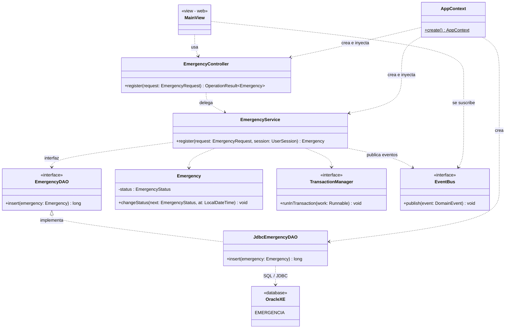

---

## 1. Capa Model — entidades

Las 23 tablas se reparten en cuatro diagramas. Una clase sin atributos (por ejemplo `User` en el diagrama 1.3) es una referencia a una clase definida en otro diagrama de esta sección.

### 1.1 Tipos compartidos

`GeoPoint` reemplaza los pares latitud/longitud y sabe calcular distancias (*Information Expert*). Las cinco entidades con ubicación implementan `Locatable`, así que un servicio puede buscar "la más cercana" de cualquiera de ellas con el mismo código (*Polymorphism*).

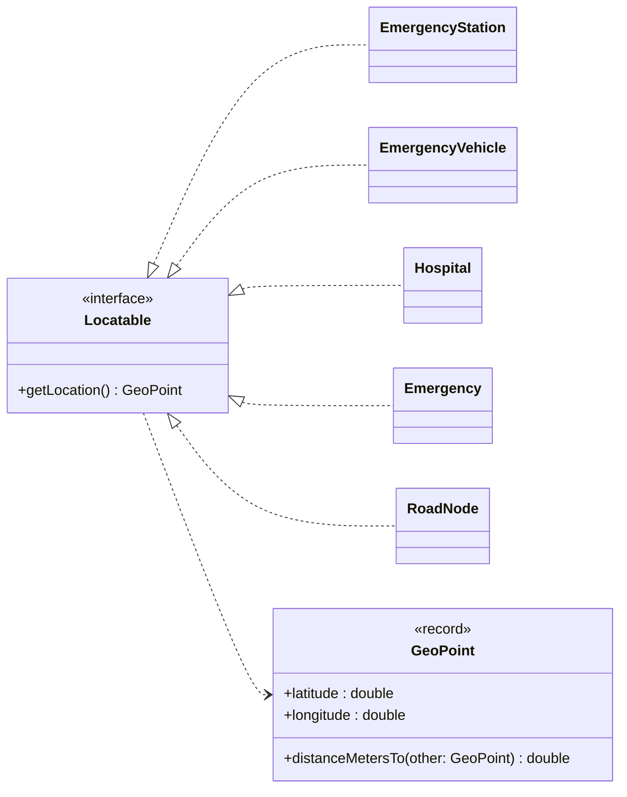

### 1.2 Seguridad, alertas y auditoría

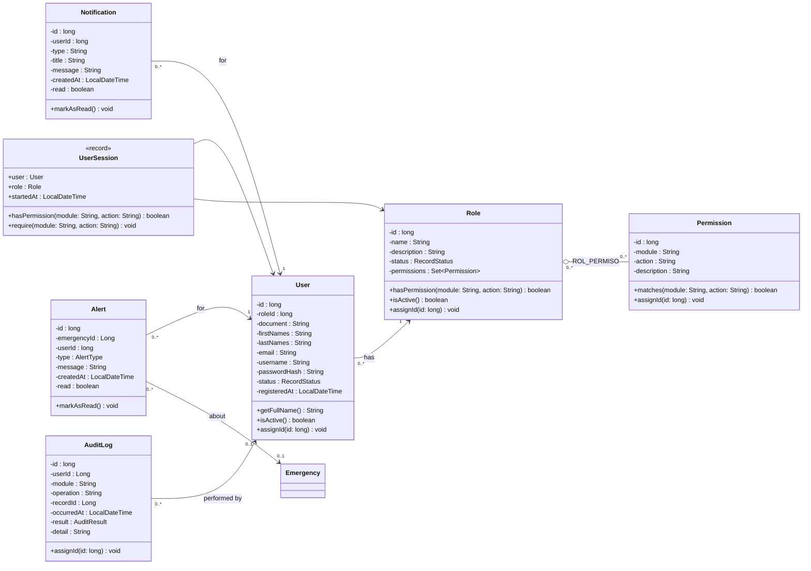

### 1.3 Emergencias, unidades, hospitales y rutas

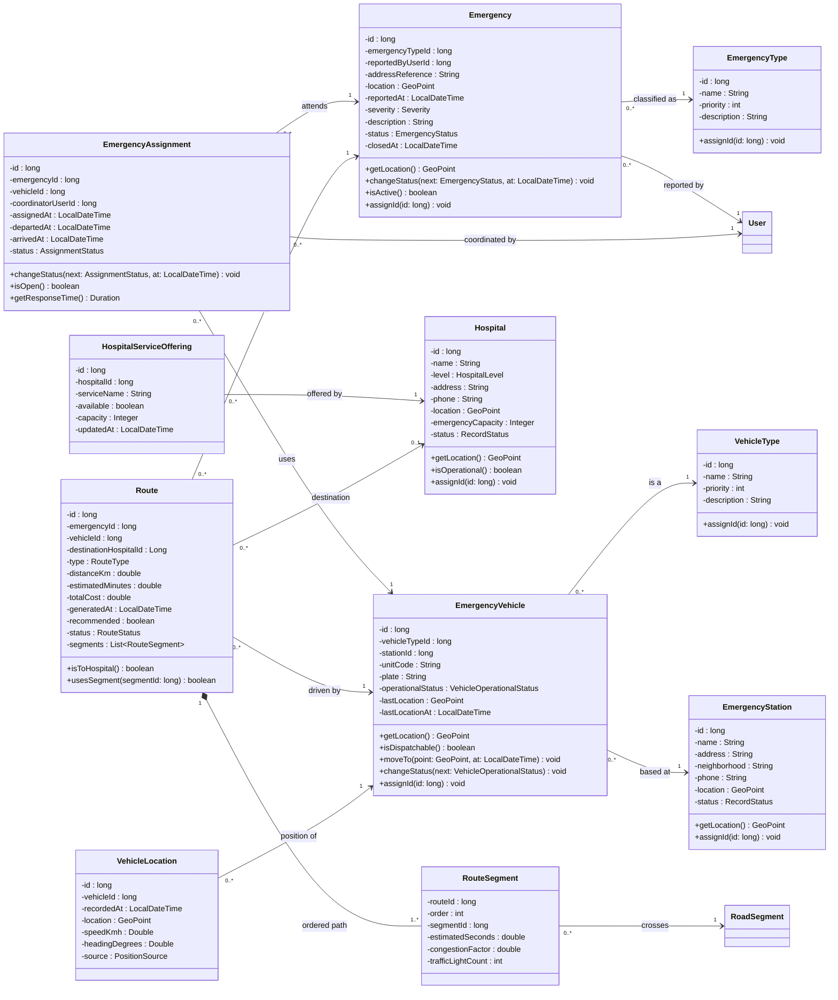

### 1.4 Red vial y tráfico

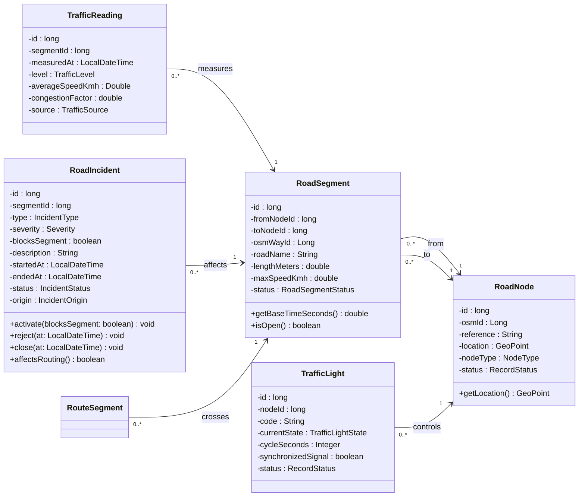

**Correspondencia con las tablas:** cada entidad equivale a una tabla (`Emergency` ↔ `EMERGENCIA`, `RoadSegment` ↔ `TRAMO_VIAL`…). Hay dos excepciones:

- `ROL_PERMISO` no es una clase: se representa con `Role.permissions`.
- `UserSession` no es una tabla: guarda en memoria quién inició sesión.

---

## 2. Capa Model — enumeraciones

Las 19 enumeraciones implementan `CodedEnum`: la constante va en inglés y `code()` devuelve el valor que guarda Oracle (por ejemplo, `EN_ROUTE` → `"EN_RUTA"`). `EnumSqlContractTest` comprueba que coincidan con los CHECK de la base de datos.

### 2.1 Estados con reglas de transición

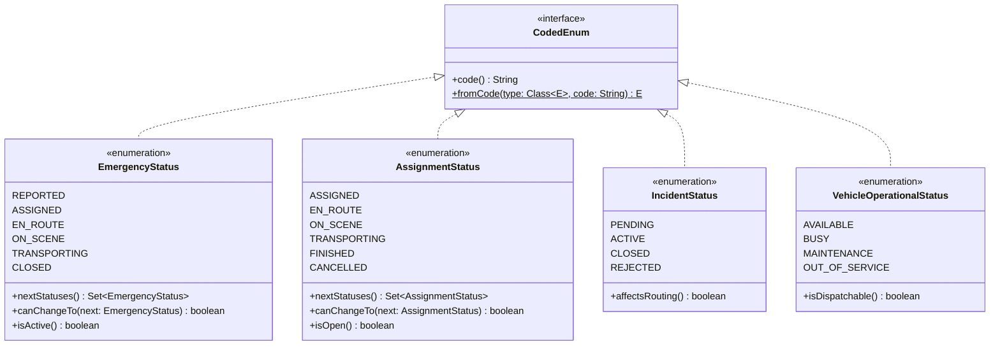

### 2.2 Catálogos

Todas implementan `CodedEnum` (la flecha se omite).

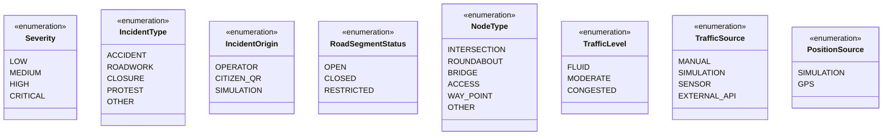

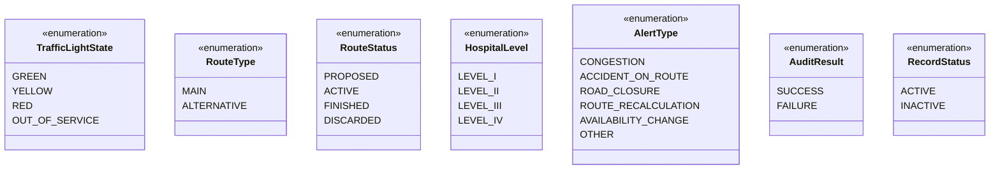

---

## 3. Capa DAO — interfaces

Cada interfaz declara **solo** los métodos que necesitan los casos de uso (SOLID: segregación de interfaces). Las tablas de historial (`TRAFICO`, `UBICACION_VEHICULO`, `AUDITORIA`) solo admiten inserción. Cada DAO depende de la entidad que lee o escribe.

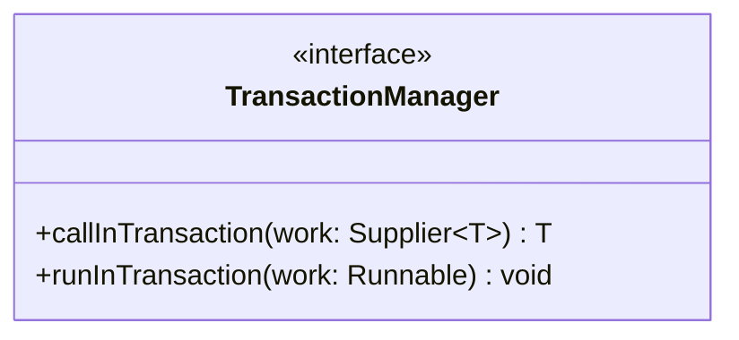

`TransactionManager` agrupa varias operaciones de DAO en una sola transacción.

### 3.1 Seguridad, emergencias y despacho

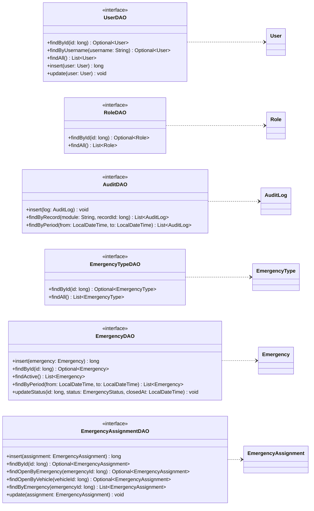

### 3.2 Flota y hospitales

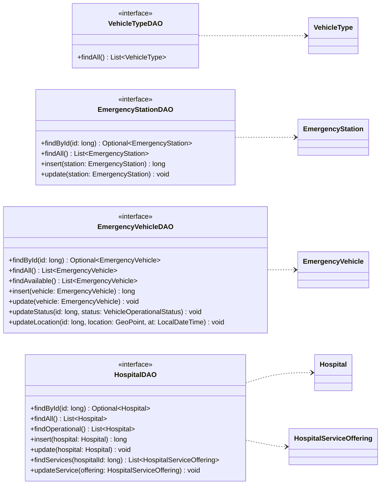

### 3.3 Red vial, tráfico e incidentes

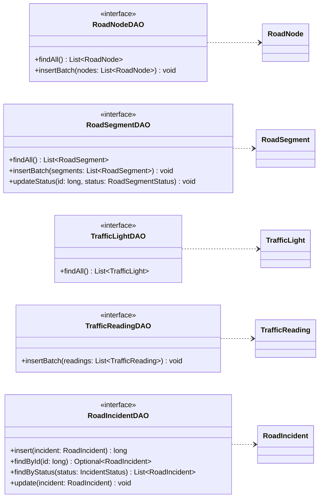

### 3.4 Rutas, seguimiento y alertas

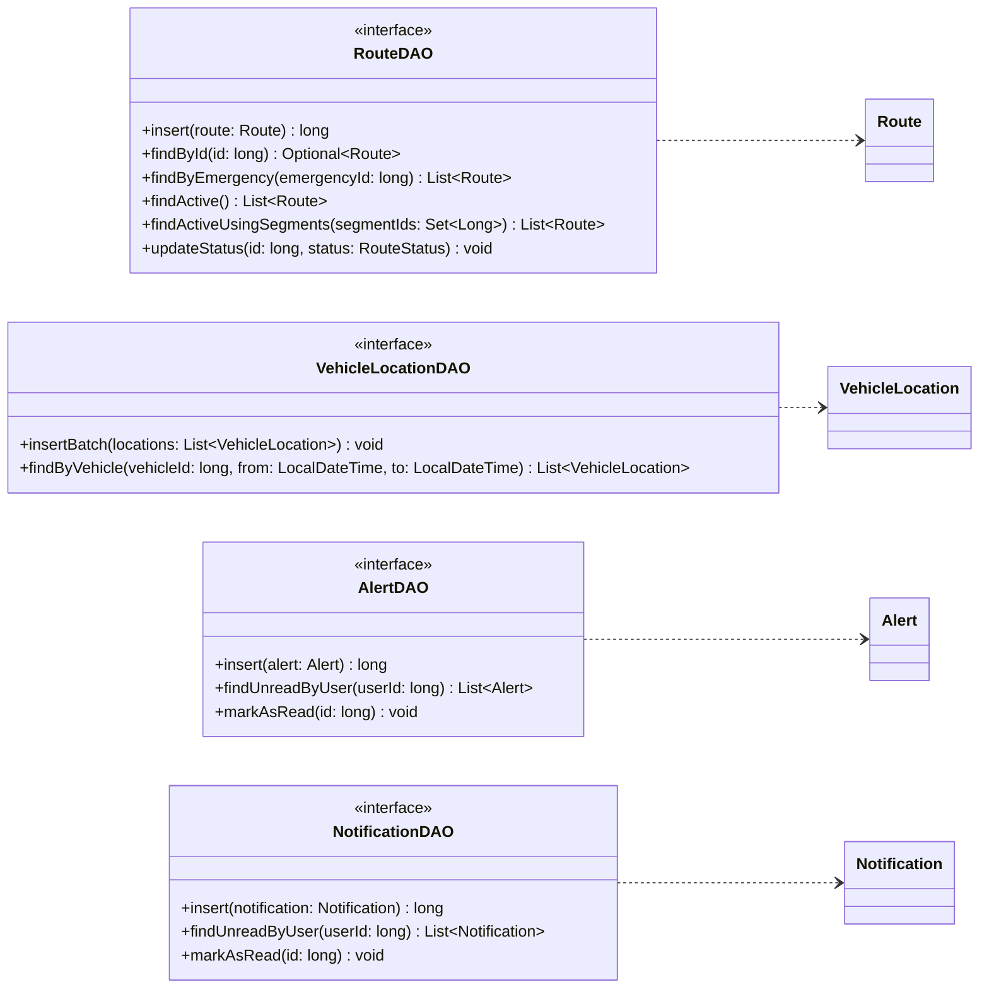

---

## 4. Capa DAO — implementación JDBC (Oracle)

Toda implementación hereda de `AbstractJdbcDAO`, que reúne el manejo repetido de JDBC: obtener la conexión, ejecutar con parámetros y convertir `SQLException`. Cada `JdbcXxxDAO` solo escribe su SQL y su mapeo fila → objeto (patrón *Template Method*).

```mermaid
---
config:
  markdownAutoWrap: false
---
classDiagram
    direction TB

    class TransactionManager {
        <<interface>>
        +callInTransaction(work: Supplier~T~) T
        +runInTransaction(work: Runnable) void
    }
    class ConnectionProvider {
        <<interface>>
        +withConnection(work: SqlWork~T~) T
    }
    class SqlWork~T~ {
        <<interface>>
        +apply(connection: Connection) T
    }
    class ConnectionFactory {
        <<interface>>
        +open() Connection
    }
    
    class ClientIdentifierConnectionFactory {
        -delegate : ConnectionFactory
        -currentUserId : Supplier~Long~
        +open() Connection
    }
    
    class JdbcTransactionManager {
        -factory : ConnectionFactory
        -current : ThreadLocal~Connection~
        +callInTransaction(work: Supplier~T~) T
        +withConnection(work: SqlWork~T~) T
        +isInTransaction() boolean
    }
    class RowMapper~T~ {
        <<interface>>
        +map(row: ResultSet) T
    }
    class AbstractJdbcDAO {
        <<abstract>>
        #connections : ConnectionProvider
        #queryList(sql: String, mapper: RowMapper~T~, params: Object[]) List~T~
        #queryOne(sql: String, mapper: RowMapper~T~, params: Object[]) Optional~T~
        #execute(sql: String, params: Object[]) int
        #insertReturningId(sql: String, idColumn: String, params: Object[]) long
        #bind(statement: PreparedStatement, params: Object[]) void$
        #getLocalDateTime(row: ResultSet, column: String) LocalDateTime$
        #getNullableLong(row: ResultSet, column: String) Long$
        #getNullableInt(row: ResultSet, column: String) Integer$
        #getFlag(row: ResultSet, column: String) boolean$
        #callProcedure(call: String, params: Object[]) void
        #callProcedureReturningLong(call: String, inParams: Object[]) long
    }
    class DatabaseConnection {
        +fromEnvironment() DatabaseConnection$
        +open() Connection
        +url() String
        +user() String
    }

    TransactionManager <|.. JdbcTransactionManager
    ConnectionProvider <|.. JdbcTransactionManager
    ConnectionProvider ..> SqlWork~T~
    JdbcTransactionManager --> ConnectionFactory
    ConnectionFactory <|.. ClientIdentifierConnectionFactory
    ClientIdentifierConnectionFactory --> ConnectionFactory : decora
    ConnectionFactory <.. DatabaseConnection : open() cumple el contrato
    AbstractJdbcDAO --> ConnectionProvider
    AbstractJdbcDAO ..> RowMapper~T~

    class JdbcUserDAO
    class JdbcRoleDAO
    class JdbcAuditDAO
    class JdbcEmergencyTypeDAO
    class JdbcEmergencyDAO
    class JdbcEmergencyAssignmentDAO
    class JdbcVehicleTypeDAO
    class JdbcEmergencyStationDAO
    class JdbcEmergencyVehicleDAO
    class JdbcHospitalDAO
    class JdbcRoadNodeDAO
    class JdbcRoadSegmentDAO
    class JdbcTrafficLightDAO
    class JdbcTrafficReadingDAO
    class JdbcRoadIncidentDAO
    class JdbcRouteDAO
    class JdbcVehicleLocationDAO
    class JdbcAlertDAO
    class JdbcNotificationDAO

    AbstractJdbcDAO <|-- JdbcUserDAO
    AbstractJdbcDAO <|-- JdbcRoleDAO
    AbstractJdbcDAO <|-- JdbcAuditDAO
    AbstractJdbcDAO <|-- JdbcEmergencyTypeDAO
    AbstractJdbcDAO <|-- JdbcEmergencyDAO
    AbstractJdbcDAO <|-- JdbcEmergencyAssignmentDAO
    AbstractJdbcDAO <|-- JdbcVehicleTypeDAO
    AbstractJdbcDAO <|-- JdbcEmergencyStationDAO
    AbstractJdbcDAO <|-- JdbcEmergencyVehicleDAO
    AbstractJdbcDAO <|-- JdbcHospitalDAO
    AbstractJdbcDAO <|-- JdbcRoadNodeDAO
    AbstractJdbcDAO <|-- JdbcRoadSegmentDAO
    AbstractJdbcDAO <|-- JdbcTrafficLightDAO
    AbstractJdbcDAO <|-- JdbcTrafficReadingDAO
    AbstractJdbcDAO <|-- JdbcRoadIncidentDAO
    AbstractJdbcDAO <|-- JdbcRouteDAO
    AbstractJdbcDAO <|-- JdbcVehicleLocationDAO
    AbstractJdbcDAO <|-- JdbcAlertDAO
    AbstractJdbcDAO <|-- JdbcNotificationDAO
```

Cada `JdbcXxxDAO` implementa la interfaz `XxxDAO` del mismo nombre de la sección 3 (por ejemplo, `JdbcEmergencyDAO` implementa `EmergencyDAO`). Esas 19 flechas de realización no se dibujan para que el diagrama se pueda leer.

---

## 5. Capa Service — reglas de negocio, DTO y utilidades

### 5.1 Servicios

Cada servicio agrupa las reglas de un área del negocio (*High Cohesion*) y recibe sus dependencias por constructor.

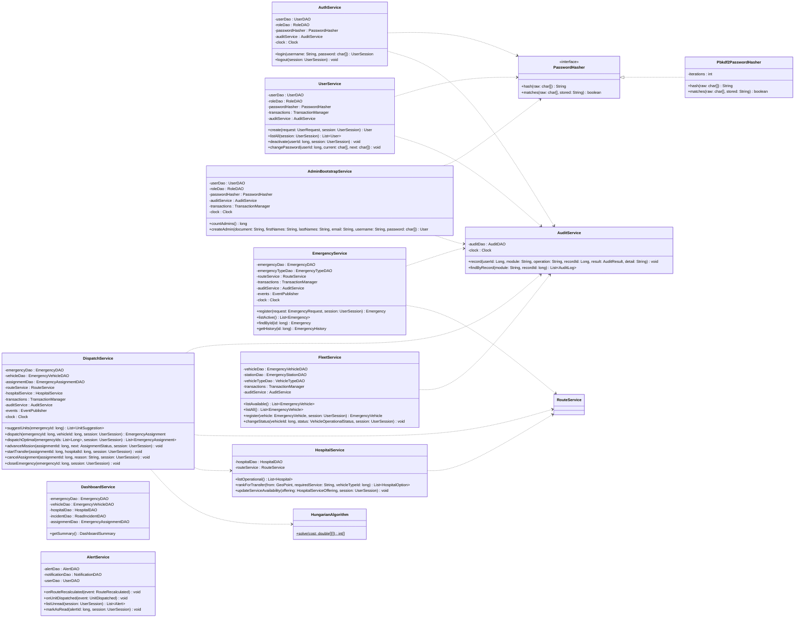

### 5.2 DTO y utilidades

Los DTO (paquete `dto`) son *records* sin lógica que viajan entre el controlador y la vista. Las utilidades (paquete `util`) no tienen reglas de negocio.

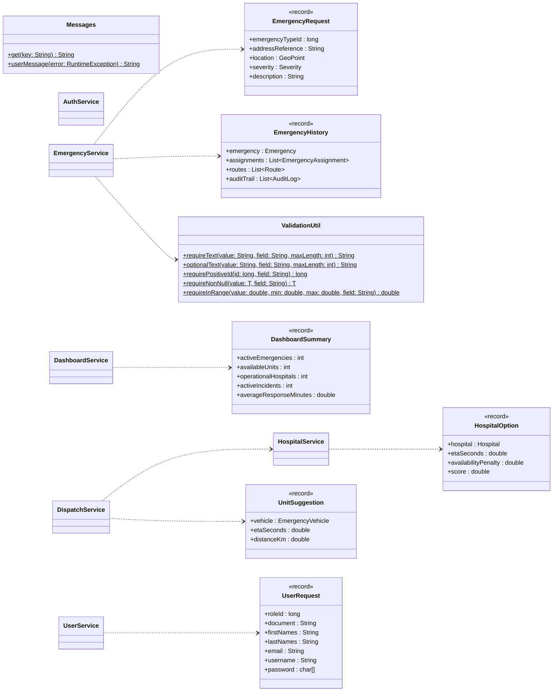

Los atributos de cada servicio son sus dependencias, que recibe por constructor. Los tipos `XxxDAO` son las interfaces de la sección 3, nunca las clases `JdbcXxxDAO`.

---

## 6. Motor de rutas, tráfico y simulación

### 6.1 Grafo y algoritmo de rutas (paquete `graph`, Kendrick)

El grafo vive en memoria: la topología (`Node`, `Edge`) no cambia y el estado de cada tramo (`EdgeState`) se reemplaza completo en cada actualización. `CostFunction` permite cambiar el criterio de costo sin tocar `AStarRouter` (SOLID: abierto/cerrado).

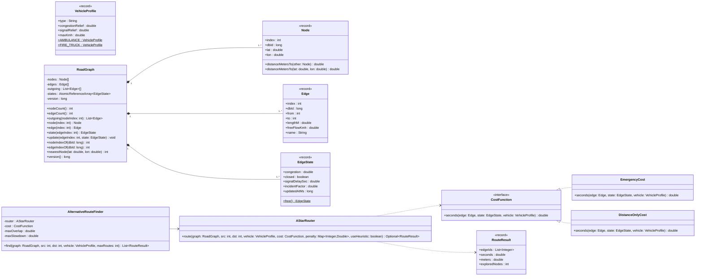

### 6.2 Rutas, tráfico, incidentes y recálculo (paquetes `service` y `traffic`)

`RoadConditionService` es el único que modifica el grafo. `TrafficProvider` aísla de dónde viene el tráfico: en la fase 1 lo genera el simulador y en la fase 2 una fuente externa, sin cambiar el resto (*Protected Variations*).

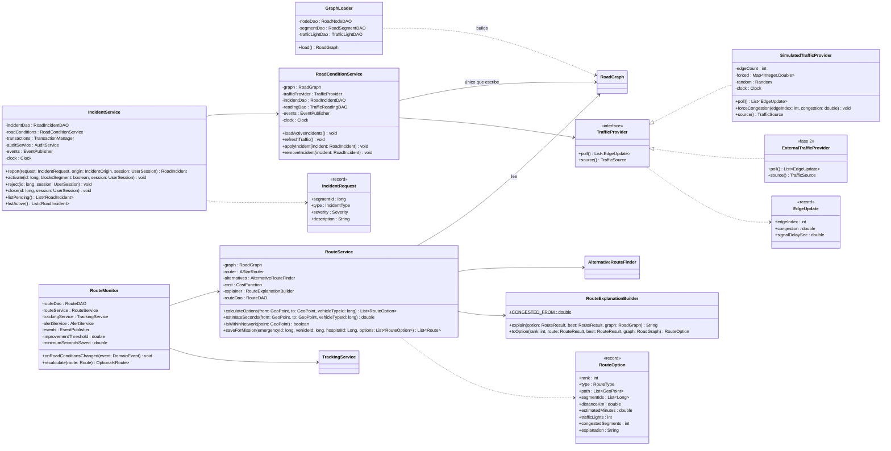

### 6.3 Simulación y seguimiento (paquetes `simulation` y `service`)

`VehiclePositionSource` cumple el mismo papel que `TrafficProvider` para las posiciones: hoy las produce `VehicleMovementSimulator` y en la fase 2 un GPS real. La interfaz se define en `service` (quien la usa) y la implementa `simulation` (SOLID: inversión de dependencias).

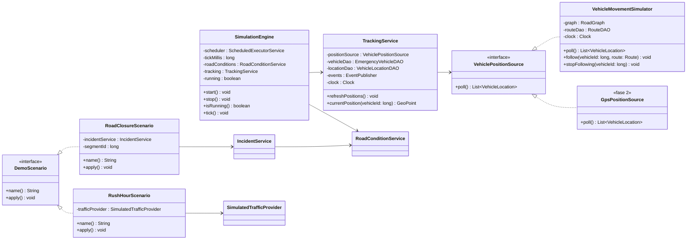

**Cambios respecto al diseño del documento consolidado (Parte IV):**

- **`Node` y `Edge` tienen `dbId`.** El grafo usa índices `0..n-1`, pero necesita volver al `id` de Oracle para guardar `RUTA_TRAMO`.
- **`EdgeState` incorpora `incidentFactor`.** Así un incidente puede penalizar un tramo sin cerrarlo.
- **`EdgeUpdate` ya no tiene `closed`.** El simulador no cierra tramos (regla RN-06).
- **`AlternativeRoutesService` se llama ahora `AlternativeRouteFinder`.** Así no se confunde con la capa Service.
- **Hay un `DistanceOnlyCost` nuevo.** Permite comparar en la sustentación la ruta más corta con la más rápida.
- **`RoadConditionService` es el único que modifica el grafo.** Combina tráfico e incidentes según la sección 5 de `docs/convenciones-base-datos.md`.

---

## 7. Eventos de tiempo real y excepciones

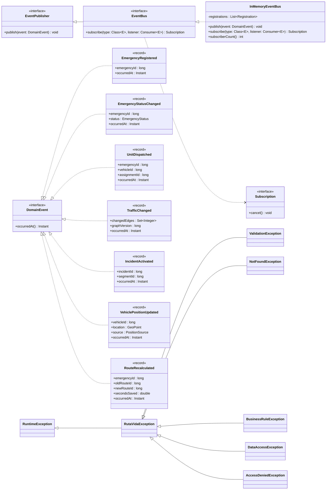

| Evento | Lo publica | Lo escuchan |
|---|---|---|
| `EmergencyRegistered` | `EmergencyService` | Vista (mapa y lista) |
| `UnitDispatched` | `DispatchService` | Vista, `AlertService`, `VehicleMovementSimulator` |
| `EmergencyStatusChanged` | `DispatchService` | Vista |
| `TrafficChanged` | `RoadConditionService` | `RouteMonitor`, vista (tramos congestionados) |
| `IncidentActivated` | `IncidentService` | `RouteMonitor`, vista |
| `VehiclePositionUpdated` | `TrackingService` | Vista (mueve el ícono de la unidad) |
| `RouteRecalculated` | `RouteMonitor` | Vista (nueva ruta), `AlertService` |

---

## 8. Capas Controller, View y App

### 8.1 Controladores

Un controlador por grupo de casos de uso (*GRASP Controller*). Devuelven `OperationResult` para que la vista muestre el mensaje sin manejar excepciones.

```mermaid
---
config:
  markdownAutoWrap: false
---
classDiagram
    direction LR

    class SessionContext {
        -current : UserSession
        +start(session: UserSession) void
        +current() UserSession
        +end() void
        +isActive() boolean
    }
    class OperationResult~T~ {
        <<record>>
        +success : boolean
        +message : String
        +value : T
        +ok(value: T) OperationResult~T~$
        +error(message: String) OperationResult~T~$
    }
    class LoginController {
        -authService : AuthService
        -session : SessionContext
        +login(username: String, password: char[]) OperationResult~UserSession~
        +logout() void
    }
    class EmergencyController {
        -emergencyService : EmergencyService
        -session : SessionContext
        +register(request: EmergencyRequest) OperationResult~Emergency~
        +listActive() List~Emergency~
        +history(emergencyId: long) OperationResult~EmergencyHistory~
    }
    class DispatchController {
        -dispatchService : DispatchService
        -hospitalService : HospitalService
        -session : SessionContext
        +suggestUnits(emergencyId: long) OperationResult~List~UnitSuggestion~~
        +dispatch(emergencyId: long, vehicleId: long) OperationResult~EmergencyAssignment~
        +advance(assignmentId: long, next: AssignmentStatus) OperationResult~Void~
        +rankHospitals(assignmentId: long, requiredService: String) OperationResult~List~HospitalOption~~
        +startTransfer(assignmentId: long, hospitalId: long) OperationResult~Void~
        +close(emergencyId: long) OperationResult~Void~
    }
    class RouteController {
        -routeService : RouteService
        -session : SessionContext
        +options(emergencyId: long, vehicleId: long) OperationResult~List~RouteOption~~
    }
    class IncidentController {
        -incidentService : IncidentService
        -session : SessionContext
        +report(request: IncidentRequest) OperationResult~RoadIncident~
        +activate(incidentId: long, blocksSegment: boolean) OperationResult~Void~
        +reject(incidentId: long) OperationResult~Void~
        +listPending() List~RoadIncident~
    }
    class DashboardController {
        -dashboardService : DashboardService
        +summary() DashboardSummary
    }
    class AlertController {
        -alertService : AlertService
        -session : SessionContext
        +unread() List~Alert~
        +markAsRead(alertId: long) void
    }
    class SimulationController {
        -engine : SimulationEngine
        -scenarios : List~DemoScenario~
        -session : SessionContext
        +start() OperationResult~Void~
        +stop() OperationResult~Void~
        +scenarioNames() List~String~
        +run(scenarioName: String) OperationResult~Void~
    }
    class UserController {
        -userService : UserService
        -session : SessionContext
        +create(request: UserRequest) OperationResult~User~
        +list() List~User~
        +deactivate(userId: long) OperationResult~Void~
    }
    class FleetController {
        -fleetService : FleetService
        -session : SessionContext
        +listAll() List~EmergencyVehicle~
        +changeStatus(vehicleId: long, status: VehicleOperationalStatus) OperationResult~Void~
    }
    class HospitalController {
        -hospitalService : HospitalService
        -session : SessionContext
        +listOperational() List~Hospital~
        +updateService(offering: HospitalServiceOffering) OperationResult~Void~
    }

    LoginController --> SessionContext
    LoginController --> AuthService
    EmergencyController --> SessionContext
    DispatchController --> SessionContext
    LoginController ..> OperationResult~T~
    EmergencyController ..> OperationResult~T~
    DispatchController ..> OperationResult~T~
```

### 8.2 Vista y arranque

La vista solo usa controladores. `AppContext` crea todos los objetos e inyecta las dependencias.

```mermaid
---
config:
  markdownAutoWrap: false
---
classDiagram
    direction LR

    class LoginView {
        <<view>>
    }
    class MainView {
        <<view>>
    }
    class MapView {
        <<view>>
    }
    class EmergencyFormView {
        <<view>>
    }
    class DispatchView {
        <<view>>
    }
    class AppContext {
        -database : DatabaseConnection
        -jdbc : JdbcTransactionManager
        -events : EventBus
        -clock : Clock
        -session : SessionContext
        -adminBootstrap : AdminBootstrapService
        -loginController : LoginController
        +create() AppContext$
        +transactions() TransactionManager
        +events() EventBus
        +clock() Clock
        +database() DatabaseConnection
        +session() SessionContext
        +loginController() LoginController
        +adminBootstrap() AdminBootstrapService
    }
    class Main {
        +main(args: String[]) void$
    }
    class DatabaseCheck {
        +main(args: String[]) void$
    }
    class CreateAdminUser {
        +main(args: String[]) void$
    }
    class LoginController
    class EmergencyController
    class DispatchController
    class RouteController
    class IncidentController
    class DashboardController
    class AlertController
    class SimulationController

    LoginView ..> LoginController
    MainView ..> DashboardController
    MainView ..> AlertController
    MainView ..> SimulationController
    MapView ..> RouteController
    MapView ..> IncidentController
    EmergencyFormView ..> EmergencyController
    DispatchView ..> DispatchController
    MainView *-- MapView
    Main ..> AppContext : crea
    Main ..> LoginView : muestra
    CreateAdminUser ..> AppContext : usa
    CreateAdminUser ..> AdminBootstrapService : crea el administrador
    AppContext ..> LoginController : crea e inyecta
    AppContext ..> EmergencyController : crea e inyecta
    AppContext ..> DispatchController : crea e inyecta
```

Los controladores atrapan las `RutaVidaException` y devuelven un `OperationResult` con el mensaje en español de `Messages`. La vista no maneja excepciones técnicas.

La vista es web (decisión DT-01 en `docs/decisiones-tecnicas.md`). Las clases de esta sección son provisionales: en el backend se reemplazarán por los adaptadores REST del paquete `api`, que solo pueden usar controladores, DTO, modelo y eventos (`ArchitectureTest`). La página web (HTML, CSS, JavaScript y Leaflet) no forma parte de este diagrama de clases Java.

---

## 9. Estado de implementación

| Clase o grupo | Paquete | Estado |
|---|---|---|
| `CodedEnum` y las 19 enumeraciones | `model.enums` | **Programado y probado** |
| `TransactionManager`, `ConnectionProvider`, `ConnectionFactory`, `JdbcTransactionManager` | `dao`, `dao.jdbc` | **Programado y probado** |
| `DomainEvent`, `EventPublisher`, `EventBus`, `InMemoryEventBus` | `event` | **Programado y probado** |
| `RutaVidaException`, `ValidationException`, `NotFoundException`, `BusinessRuleException`, `DataAccessException` | `exception` | **Programado** |
| `DatabaseConnection`, `AppContext`, `DatabaseCheck` | `util`, `app` | **Programado y probado** contra Oracle XE 18c |
| `RowMapper`, `AbstractJdbcDAO` | `dao.jdbc` | **Programado y probado** contra Oracle XE 18c (8 pruebas de integración) |
| `AccessDeniedException` | `exception` | **Programado y probado** |
| `CreateAdminUser`, `AdminBootstrapService`, `ClientIdentifierConnectionFactory` y el inicio de sesión conectado en `AppContext` | `app`, `service`, `dao.jdbc` | **Programado y probado** contra Oracle XE 18c (A3) |
| `GeoPoint`, `Locatable`, `UserSession`, `ValidationUtil`, `EmergencyType`, `VehicleType`, `Permission`, `Role`, `User`, `EmergencyStation`, `Hospital`, `EmergencyVehicle`, `Emergency` | `model`, `util` | **Programado y probado** |
| Otras entidades de la sección 1, pendientes de implementación | `model` | Diseñado |
| `AuditLog` | `model` | **Programado y probado** (creado por Andrés con el contrato de S1; ver `docs/contratos-entidades.md`, sección 3) |
| `UserDAO`, `RoleDAO`, `AuditDAO` (interfaces) | `dao` | **Programado** (A2) |
| `JdbcUserDAO`, `JdbcRoleDAO`, `JdbcAuditDAO` | `dao.jdbc` | **Programado y probado** contra Oracle XE 18c (17 pruebas de integración) |
| Demás interfaces DAO y `JdbcXxxDAO` | `dao`, `dao.jdbc` | Diseñado |
| `AuthService`, `AuditService`, `PasswordHasher`, `Pbkdf2PasswordHasher` | `service`, `util` | **Programado y probado** (S2) |
| Demás servicios y DTO | `service`, `dto` | Diseñado |
| Motor de rutas | `graph` | **Programado y probado** |
| Tráfico | `traffic` | **Programado y probado** |
| `RouteOption`, `RouteExplanationBuilder` | `dto`, `service` | **Programado y probado** (K3) |
| Simulación | `simulation` | Diseñado |
| Eventos concretos (`UnitDispatched`…) | `event` | Diseñado |
| `LoginController`, `SessionContext`, `OperationResult`, `Messages` | `controller`, `dto`, `util` | **Programado y probado** (S3) |
| Demás controladores | `controller` | Diseñado |
| Vista web y adaptadores REST | `view` → `api`, `frontend/` | Decidido (web); pendiente de programar |

Estos son los contratos que el equipo debe respetar. Si alguien necesita cambiar una firma pública, lo acuerda con el equipo y actualiza este diagrama en el mismo Pull Request.
