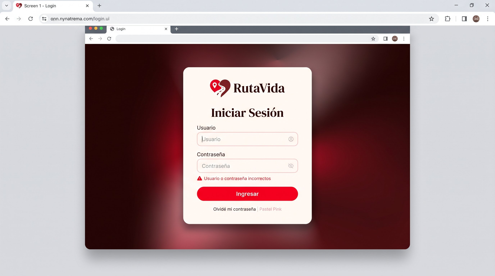
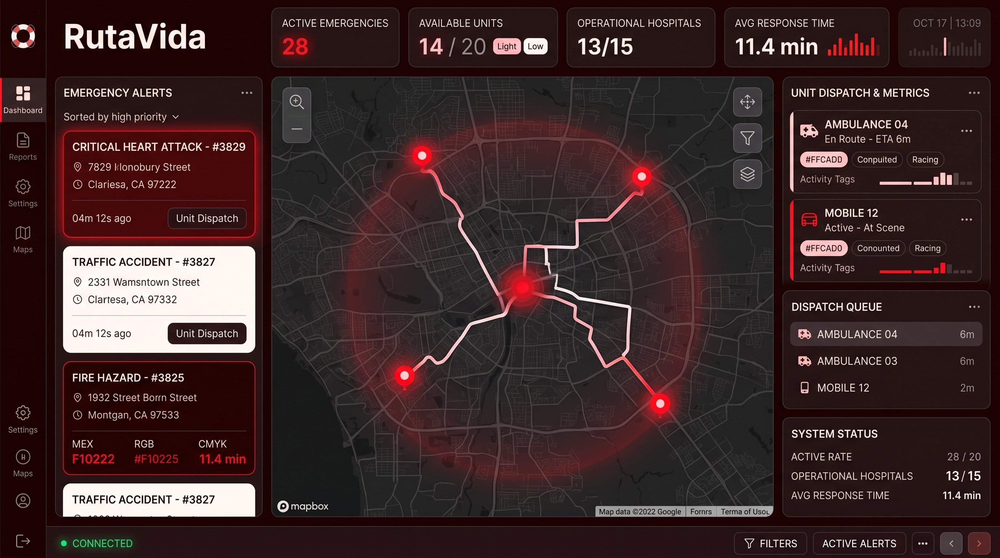
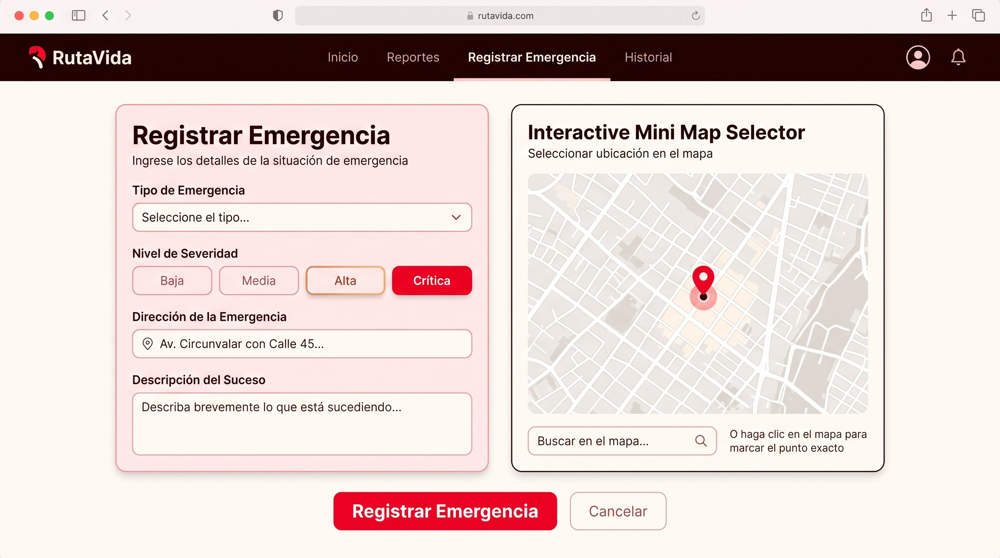
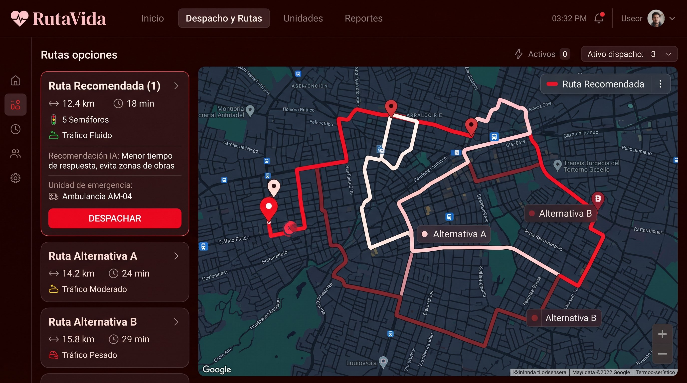
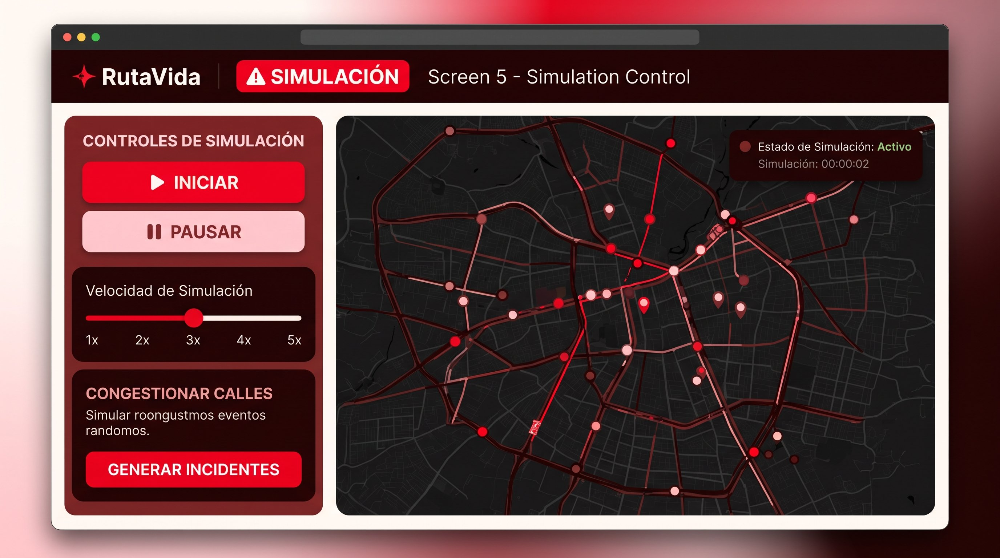

# Mockups de RutaVida

Diseño de la interfaz web (decisión DT-01).

Los números que aparecen son datos de ejemplo, no resultados del sistema.

| # | Pantalla | Caso de uso | Imagen |
|---|---|---|---|
| 1 | Inicio de sesión | CU-01 |  |
| 2 | Principal | CU-07, CU-16 |  |
| 3 | Registrar emergencia | CU-06 |  |
| 4 | Despacho y rutas | CU-08, CU-09 |  |
| 5 | Control de simulación | CU-18, CU-19 |  |